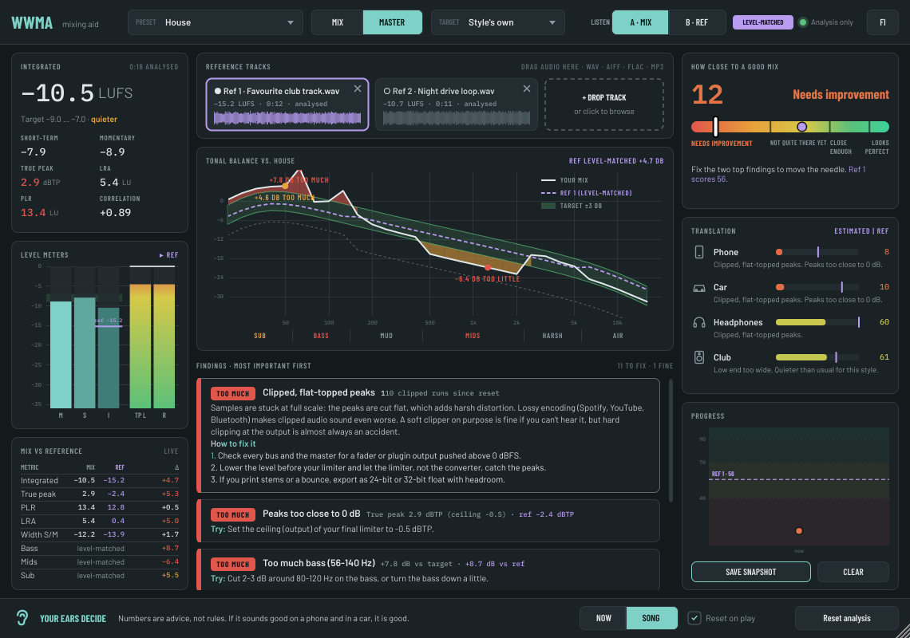
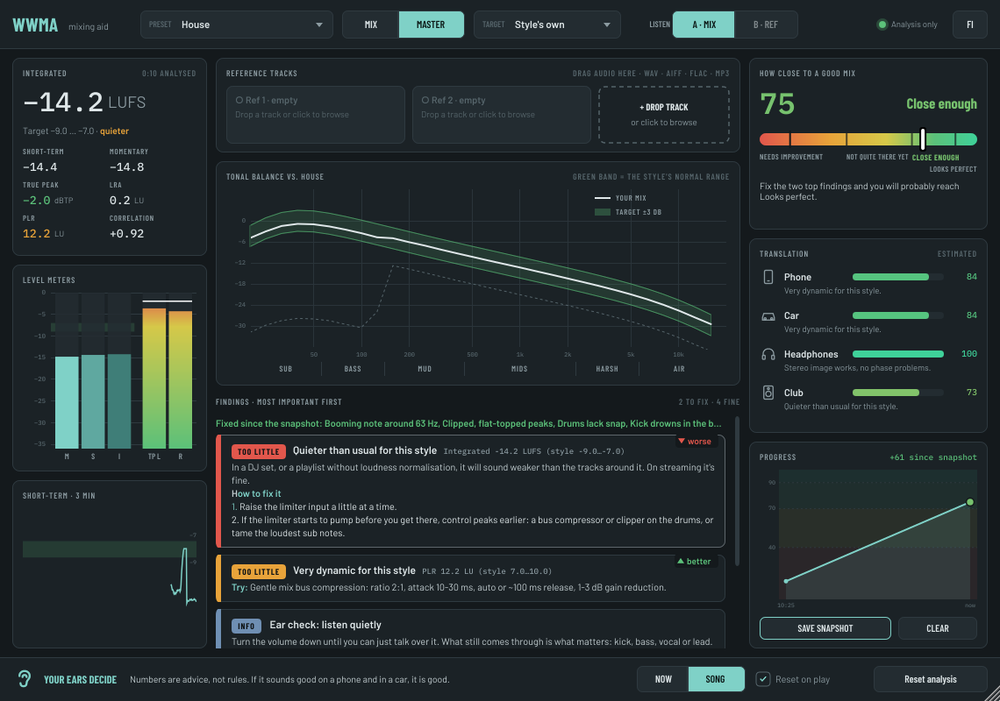
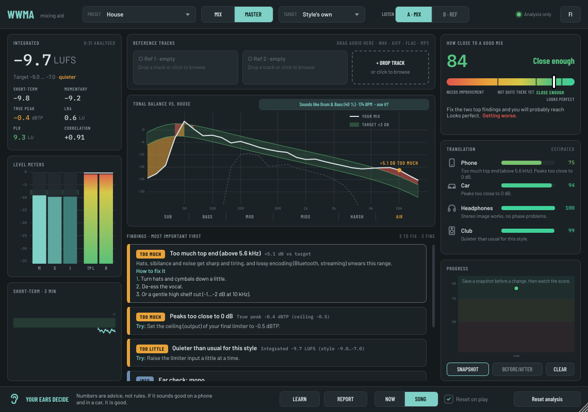

# WWMA – Washable and Withstanding Mixing Aid

A free, open source mixing teacher in a plugin (VST3, CLAP, AU on macOS and LV2 on Linux, for Windows, macOS and Linux, x64 and ARM).

Put it last on your master bus. It listens to your mix and tells you in plain words what is **clearly** or **slightly** too much or too little, why it matters on a phone, in a car, on headphones and in a club, and how to fix it yourself. It never changes your sound.



## What it does

- **Loudness, like a pro meter.** Integrated, short-term and momentary LUFS (EBU R128 / ITU-R BS.1770-4), loudness range (LRA), 4× oversampled true peak, PLR, correlation, and a 3-minute history.
- **Tonal balance against your style.** A third-octave spectrum against a corridor for the chosen preset. Red shading shows too much, orange shows too little, and each range has a plain name: sub, bass, mud, mids, harsh, air.
- **Findings that teach.** At most four things to fix at a time, most important first. Each one has a "Try:" first step. Click a finding to see why it matters, every step, and the common trap behind it.
- **Common pitfalls built in.** Kick drowning in the bass (with sidechain ducking settings), sub without harmonics (gone on phones), wide or out-of-phase low end, over-compression and over-limiting, clipping, missing headroom while mixing, mixing into a limiter, harsh upper mids, sibilance, rumble, booming notes, piercing peaks, holes in the spectrum, wideners on the top end, left/right imbalance, DC offset, and quiet or squashed drums.
- **A rotating listening tip.** The tip changes every 30 seconds: listen quietly, check in mono, check on your phone, take a break, match loudness before comparing, and so on.
- **"How close to a good mix" meter.** A score from 0 to 100 on a red-to-green bar:
  - Needs improvement (0–40)
  - Not quite there yet (40–70)
  - Close enough (70–90)
  - Looks perfect (90–100)

  It also tells you what the next fix is worth.
- **Translation.** An estimate of how well the mix holds up on a phone, in a car, on headphones and in a club.
- **Mono check.** Warns when the bass or a wide synth gets quieter when the mix is summed to mono (club systems, phones and many Bluetooth speakers are mono).
- **Snapshots and before/after.** Save a snapshot before a change. WWMA then reminds you to save your DAW project as a new version (Save As, "My song v3") and asks you to confirm with **I saved it**, so you can always go back. **Before/after** shows every number before and now, marked better or worse. The snapshot's tonal curve stays on the spectrum as a ghost line, with the difference filled in another colour (can be turned off).
- **Learning mode.** Eight short, hands-on tasks, like "Duck the bass under the kick" or "Make it mono-safe". A bar fills up as you get closer, and WWMA tells you when you've made it.
- **Mix report.** Save a Markdown report (with a JSON copy) of the score, the findings, every number and your snapshots. A later report in the same folder shows what got better or worse since the previous one. See the [example](docs/example-report.md).
- **Reference tracks.** Drag up to two tracks (WAV, AIFF, FLAC, MP3, OGG; macOS and Windows also read M4A) onto the window. Each one is analysed once in the background. You then see:
  - its tonal curve as a dashed line
  - a live "mix vs reference" table
  - its numbers next to every finding
  - its score on the meters

  **A/B** plays the reference instead of your mix at the same loudness, following your song position. Click the waveform to jump. This is the only time WWMA changes what you hear, and only while you have B selected.
- **Mix and Master modes.** In Mix mode, loudness and ceiling are not judged yet; you get headroom advice instead.
- **Style suggestion.** After 15 seconds WWMA guesses the closest preset from the tempo (it knows half-time, so drum & bass counts as 174 BPM), the tonal balance and the dynamics, with a confidence: "Sounds like House (72 %) · 124 BPM - use it?". It only switches when you click.
- **NOW and SONG.** NOW looks at the last 3 seconds, so you can loop a part and tweak it. SONG looks at everything since the last reset.
- **English and Finnish.** Use the FI/EN button to switch.




## Presets

**Electronic:**

- House, Deep House, Tech House, Afro House, Minimal / Microhouse
- Techno, Hard Techno, Melodic Techno / Progressive
- Trance, Psytrance, EDM / Big Room
- UK Garage / Speed Garage, Breaks
- Drum & Bass, Dubstep / Bass Music, Future Bass, Hardstyle
- Synthwave, Ambient / Downtempo, Lo-fi / Chillhop
- Electronic (streaming)

**Other:**

- Hip Hop / Trap, Pop, Rock / Band, Acoustic
- Streaming safe

You can also use any loaded reference track as the target, with the "Reference track" preset.

The loudness target can follow the style, or be set to -14 LUFS (streaming), -8 LUFS (club), -6 LUFS (loud) or -16 LUFS (Apple Music).

**The ear decides.** The presets are educated guesses from common practice, not measurements of particular records, so treat every number as advice, not a rule. If it sounds good on a phone and in a car, it is good. For the most accurate target, load a record you like as a reference.

## Install

Get the installer for your system from the [Releases](../../releases) page. See [docs/INSTALL.txt](docs/INSTALL.txt) for installing by hand (including macOS quarantine and Linux paths).

The [manual](docs/MANUAL.md) explains every check and what to try first. There is also a beginner's guide to mixing with WWMA in Finnish: [docs/OPAS.md](docs/OPAS.md).



## Build

You need CMake 3.22 or newer and a C++17 compiler. JUCE 8.0.4 is downloaded automatically, or you can point `-DJUCE_DIR` at a local copy.

```
cmake -B build -DCMAKE_BUILD_TYPE=Release
cmake --build build --config Release --target WWMA_VST3
```

The self test checks:

- measurement accuracy against reference signals
- the advice on synthetic mixes
- bit-exact pass-through and stability from 22 to 192 kHz
- reference tracks and A/B level matching
- synthetic songs (kick, bass, snare, hats, pad, lead, limiter) with typical mistakes, each of which must be caught
- tempo and the style guess
- CPU load (about 2 % of one core at 48 kHz)

It also renders the screenshots.

```
cmake -B build -DWWMA_BUILD_TOOLS=ON
cmake --build build --target wwma_selftest
./build/wwma_selftest_artefacts/Release/wwma_selftest screenshots
```

`wwma_calibrate` prints what WWMA says about each synthetic mistake (or `wwma_calibrate styles` for the style guess), which is handy when tuning thresholds.

CI builds macOS (universal), Windows x64 and ARM64, and Linux x64 and ARM64. On x64 it validates the plugin with pluginval, and on ARM it runs the self test. It also builds installers, and makes a release for every `v*` tag.

## License

- WWMA is licensed under the GNU AGPL v3 (see [LICENSE](LICENSE)).
- It is built with [JUCE](https://juce.com) under the AGPL.
- The fonts are [Barlow](https://github.com/jpt/barlow) and [IBM Plex Mono](https://github.com/IBM/plex), both under the SIL Open Font License 1.1 (see `assets/fonts`).
