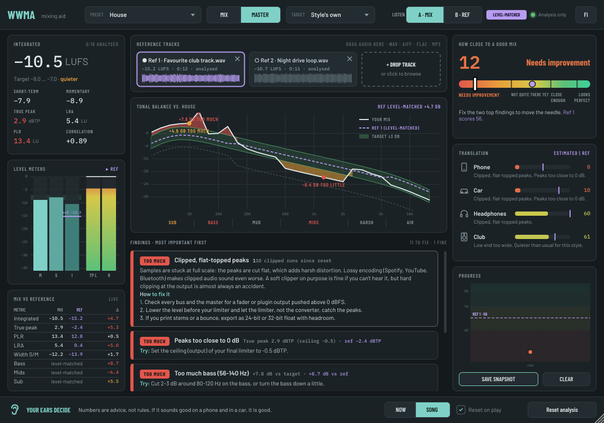
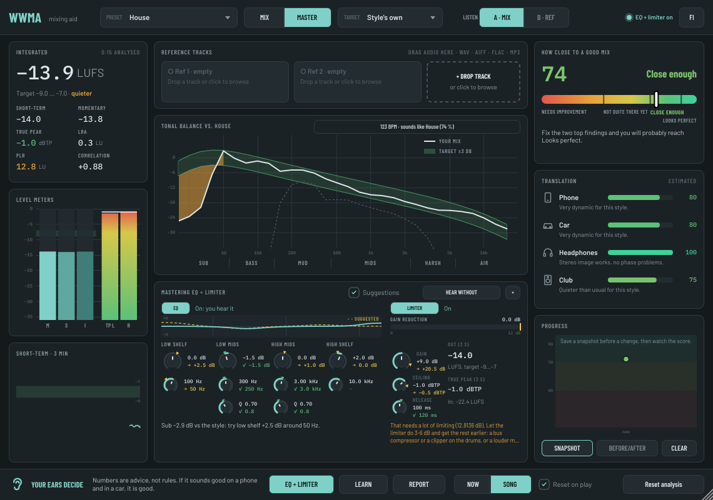
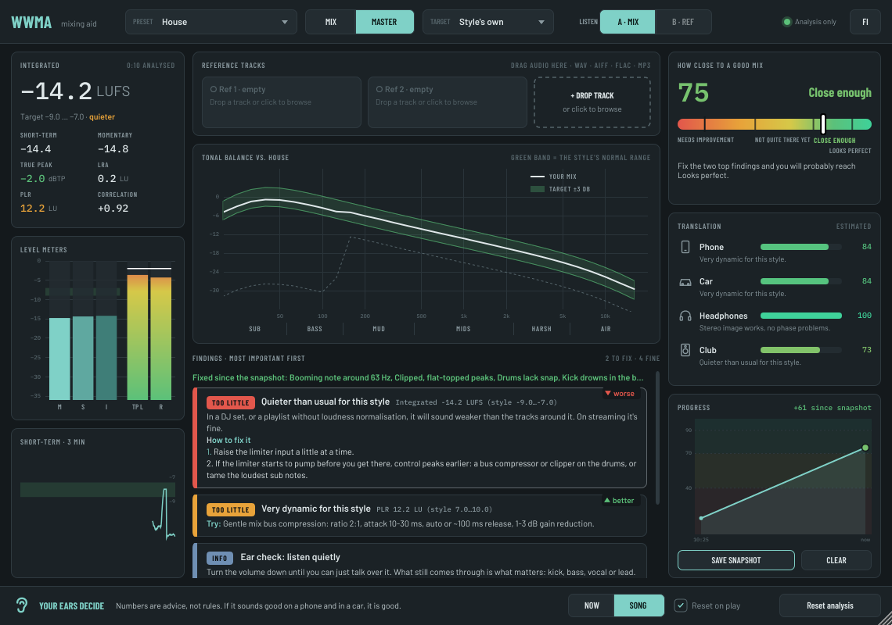
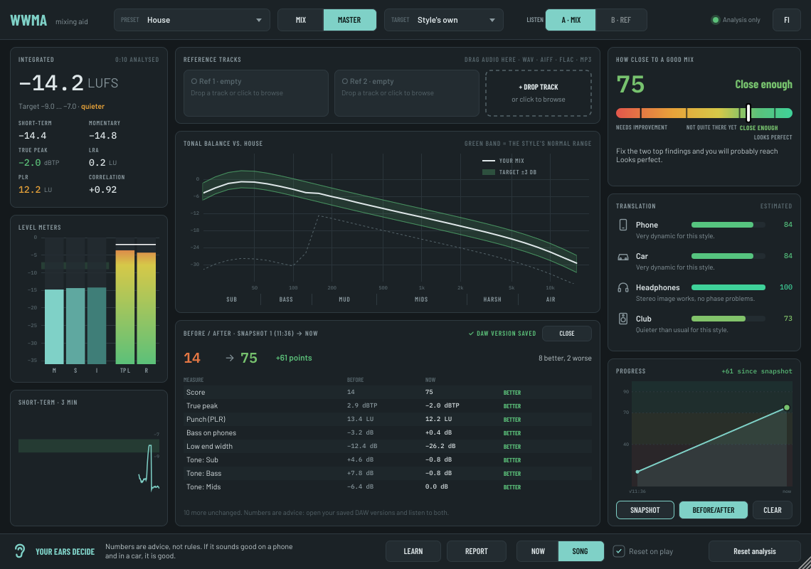
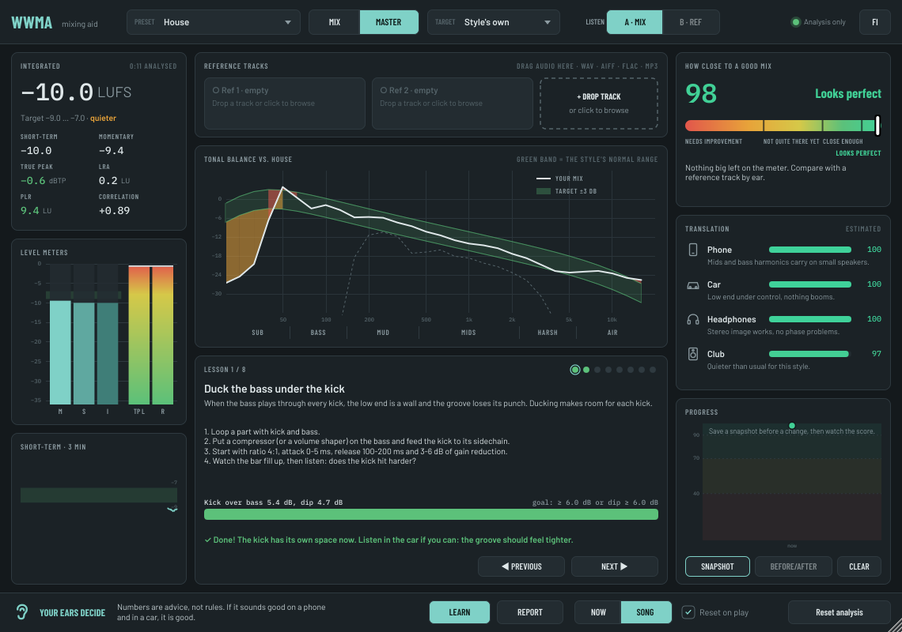
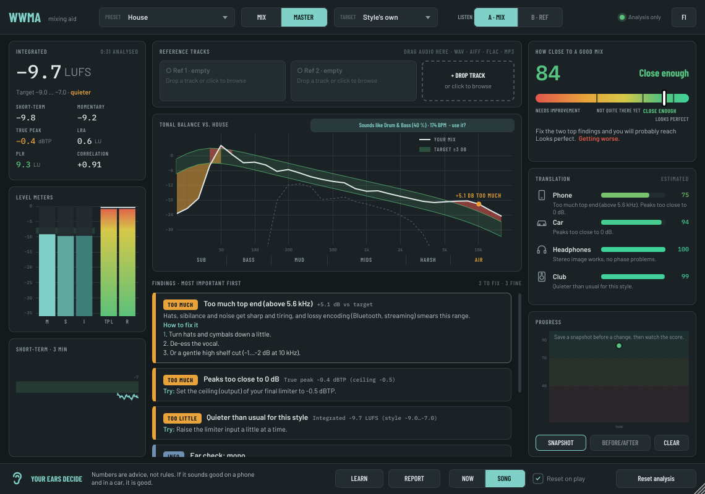

# WWMA – a free mixing teacher in a plugin

**Your mix sounds off, but you can't tell why? Put WWMA on your master bus. It listens and tells you in plain words what is too much or too little, why it matters on a phone, in a car and in a club, and what to try first.**

Free and open source. VST3, CLAP, AU (macOS) and LV2 (Linux) · Windows, macOS and Linux · x64 and ARM.

### [⬇ Download the installer (Windows, macOS, Linux)](../../releases/latest)



## Why use it

- **It tells you what to fix, in words.** Each finding names the problem (say, mud in the low mids), says how sure it is (**slightly** or **clearly**) and gives a "Try:" first step. At most four findings at a time, most important first. Click one to learn why it matters and what the usual trap is.
- **It never touches your sound.** Your audio passes through bit for bit. WWMA never turns a knob without your click, and every click can be undone.
- **Hear your changes, not just see them.** The **BEFORE** button plays your mix as it was, level-matched, at the DAW's play head, without exporting. After "Try the top fix", WWMA measures the next pass and your ears decide.
- **Compare with a record you like.** Drag in up to two reference tracks: see them on the spectrum, in a live table, and A/B them at the same loudness.
- **Pro loudness meter.** LUFS (EBU R128), LRA, 4× oversampled true peak, correlation and a mono check.
- **Learns your style.** 26 presets from House and Techno to Hip Hop, Pop and Rock, with a style guess from tempo and tonal balance.
- **Teaches while you mix.** Eight hands-on lessons, a rotating listening tip, and kick and bass checks (sidechain settings included).
- **Optional extras.** Mastering EQ and true peak limiter with suggested settings (off by default), mix reports, and asking Claude, Gemini or ChatGPT about your mix (only numbers and pictures leave your computer, never audio, and only if you allow it).

English and Finnish. Suomenkielinen aloitusopas: [docs/OPAS.md](docs/OPAS.md).

## Install in a minute

1. Download the installer for your system from the [Releases page](../../releases/latest): `Windows-x64-Setup.exe`, `macOS-Installer.pkg`, or the Linux zip. (Windows on ARM has its own installer.)
2. Run it and rescan plugins in your DAW.
3. Put **WWMA Mixing Aid** last on your master bus and press play.

**First-run warnings are expected.** The installers are not code-signed, so Windows SmartScreen may say "Windows protected your PC" (click **More info → Run anyway**), and macOS may block the plugin because it is not notarized by Apple. The exact steps are in [docs/INSTALL.txt](docs/INSTALL.txt). The whole source is here, and you can build it yourself.

**Don't trust the installer? Read the code.** Everything is here, and you can read it yourself or have an AI read it for you and look for anything harmful. The installers are built by the public GitHub Actions workflow, not on a private machine. WWMA does not phone home. The AI features are entirely optional and off until you use them: only numbers and spectrogram pictures are ever sent, never audio, and only after you allow it. Without them, nothing leaves your computer (the phone stream is off until you start it).

No DAW at hand? There is also a **standalone app** for trying out reference tracks and the analysis on audio files.

Honest note: WWMA was built entirely with an AI coding assistant, not by a seasoned plugin developer. It is tested (see the self test below) but may still have bugs, and there is no warranty. Bug reports are very welcome in [Issues](../../issues).

The [manual](docs/MANUAL.md) explains every check and what to try first.

## Everything it does

- **Loudness, like a pro meter.** Integrated, short-term and momentary LUFS (EBU R128 / ITU-R BS.1770-4), loudness range (LRA), 4× oversampled true peak, PLR, correlation, and a 3-minute history.
- **Tonal balance against your style.** A third-octave spectrum against a corridor for the chosen preset. Red shading shows too much, orange shows too little, and each range has a plain name: sub, bass, mud, mids, harsh, air.
- **Findings that teach.** At most four things to fix at a time, most important first. Each one has a "Try:" first step. Click a finding to see why it matters, every step, and the common trap behind it.
- **Common pitfalls built in.** Kick drowning in the bass (with sidechain ducking settings), sub without harmonics (gone on phones), wide or out-of-phase low end, over-compression and over-limiting, clipping, missing headroom while mixing, mixing into a limiter, harsh upper mids, sibilance, rumble, booming notes, piercing peaks, holes in the spectrum, wideners on the top end, left/right imbalance, DC offset, and quiet or squashed drums.
- **A rotating listening tip.** The tip changes every 30 seconds: listen quietly, check in mono, check on your phone, take a break, match loudness before comparing, and so on.
- **"How close to a good mix" meter.** Three plain levels: Needs improvement, Not quite there yet, Close enough. Past that the meter steps back: your ears decide the rest. The number (0–100) is hidden by default, because chasing it can lead a mix the wrong way; the **0-100** button brings it back.
- **BEFORE: hear your mix as it was, without exporting.** WWMA records its own output by song position while the DAW plays (or exports: one bounce covers the whole song). A snapshot freezes it, and the **BEFORE** button plays it at the DAW's play head, level-matched, following loops and jumps. A plugin can't see the DAW's undo history, so this is how WWMA gives you an A/B of before and after your changes.
- **Your ears decide.** After "Try the top fix", WWMA asks you to compare BEFORE and MIX. If BEFORE sounded better, the ears win: the finding stops counting for this song. Every finding also says what it sounds like and when it is a style choice. When many changes pile up since a snapshot, WWMA asks you to listen before you go on.
- **Versions and sessions on disk.** Every snapshot saves BEFORE as a FLAC in WWMA's own folder, with the session's state. **Versions** lists them to use, name or remove (to the trash). A WWMA taken out of a project and added back (e.g. to update it) offers to continue where it was.
- **Translation.** An estimate of how well the mix holds up on a phone, in a car, on headphones and in a club.
- **Mono check.** Warns when the bass or a wide synth gets quieter when the mix is summed to mono (club systems, phones and many Bluetooth speakers are mono).
- **Snapshots and before/after.** Save a snapshot before a change. WWMA then reminds you to save your DAW project as a new version (Save As, "My song v3") and asks you to confirm with **I saved it**, so you can always go back. **Before/after** shows every number before and now, marked better or worse. The snapshot's tonal curve stays on the spectrum as a ghost line, with the difference filled in another colour (can be turned off).
- **Did my change help?** Every time you press play (or a loop starts over) WWMA measures the pass on its own and compares it with the previous pass of the same part: *▲ Better than the last pass (+6). Better: Tone: Mud.* **Try the top fix** goes one finding at a time: WWMA gives one concrete step, you make the change and play the part again, and it tells you *It helped. Keep it*, *That made it worse: undo it* or *No clear change yet*.
- **References are judged as masters.** A mastered reference isn't told off for loud peaks, true peak, clipping or limiting, and loses no points for them; only its mix counts.
- **Learning mode.** Eight short, hands-on tasks, like "Duck the bass under the kick" or "Make it mono-safe". A bar fills up as you get closer, and WWMA tells you when you've made it.
- **Mix report.** Save a Markdown report (with a JSON copy) of the score, the findings, every number and your snapshots. A later report in the same folder shows what got better or worse since the previous one. See the [example](docs/example-report.md).
- **Listening data for an AI assistant.** The report also saves the song part by part (intro, build-up, drop, breakdown...) with loudness, tone and width for each part, a timeline, a spectrogram picture and a ready question. Attach them to a chat with an AI assistant and ask where the mix falls short. The Report button sends nothing anywhere. See the [example](docs/example-ai-report.md).
- **Ask an AI from inside WWMA: Claude, Gemini or ChatGPT.** The **AI** button saves a report and gives it to the assistant you chose, in one of three ways: **in the browser** (no key: WWMA opens the chat, you paste the files and the question), with **the assistant's own app on your computer** (Claude Code, Gemini CLI or Codex CLI, signed in with your own subscription, no API key), or with **your own API key**. Only numbers and spectrogram pictures go, never audio, and only after you allow it. The answer comes back into WWMA and is saved next to the report. Its suggestions become **Try** cards: WWMA measures the next pass and your ears decide. A fix that fits WWMA's own EQ or limiter (say, a little more bass on the whole master) also gets **Try on master**: one click sets the knobs (kept small: at most 3 dB per band, ceiling at −0.3 dBTP or lower), and **Undo** puts them back exactly. Only while mastering, never in Mix mode. Keys stay on your computer, never in the DAW project. See the [manual](docs/MANUAL.md#ask-an-ai-from-inside-wwma).
- **Report of a reference track alone.** Open a reference (click its box) and press Report: the same report and listening data, but only about that track, e.g. an older version of your song. Your current mix is not part of it, and it never counts as an earlier report of the mix.
- **Reference tracks.** Drag up to two tracks (WAV, AIFF, FLAC, MP3, OGG; macOS and Windows also read M4A) onto the window. Each one is analysed once in the background. You then see:
  - its tonal curve as a dashed line
  - a live "mix vs reference" table
  - its numbers next to every finding
  - its score on the meters

  **A/B** plays the reference instead of your mix at the same loudness, following your song position. Each reference also has its own **play/pause**, so it plays inside WWMA even with the DAW stopped. Click or drag the waveform to jump; click the track's name for a big view where you **choose a loop**, which then plays from the small strip and is saved with the project. Mark one slot as **my earlier version** and the table shows now, earlier and the reference side by side, with *closer* or *further* on every row: did the mix move towards the reference, not just away from the old bounce? This is the only time WWMA changes what you hear, and only while you have B selected or a reference playing.
- **Mastering EQ and limiter, with suggested settings.** A four-band EQ (low shelf, two bells, high shelf) and a true peak limiter (gain, ceiling, release), so you can finish a master without another plugin. WWMA works out suggested values from your mix *before* the EQ and limiter, the style and the loudness target, and shows them next to each knob and as a marker on it (green when you are there). It never moves a knob by itself: you turn them by hand, or press **Use suggested** to set the suggested values with one click (then **Keep** or **Undo**), and you can hide the suggestions. Both stages are off by default, fade in and out, and **Hear without** plays your mix without them at the same loudness, so you judge the sound and not the volume. The limiter adds a fixed 1.7 ms delay that your DAW compensates; with both stages off the sound passes through bit for bit.
- **Mix and Master modes.** In Mix mode, loudness and ceiling are not judged yet; you get headroom advice instead.
- **Track mode: kick, bass and kick + bass.** Put WWMA on a single track and pick what it is. On a kick it shows the kick's note, whether its tail rings into the off-beat bass (from the tempo), the click that phones need, boxiness, rumble and mono. On a bass it checks the harmonics phones need, the sub vs bass balance, even notes and mono. On a kick + bass bus it checks how far the kick rises above the bass, with sidechain settings from the tempo. With one WWMA on the kick and another on the bass, the two **see each other** and tell you when kick and bass peak at the same spot or the kick is out of tune with the bass. With a reference loaded, the low end is compared with the reference's. See the [manual](docs/MANUAL.md#10-track-mode-kick-bass-and-kick--bass).
- **Listen anywhere: stream to a phone.** The gear at the bottom right opens the settings, where **Start stream** sends WWMA's output to a browser on your phone, a tablet or another computer: lossless 16-bit, about a quarter of a second late, A/B and BEFORE included. Handy when you tweak the mix over a remote desktop. Off until you start it; every link has a secret part, and a password can be added. Outside your home use Tailscale, or Traefik with HTTPS ([example](docs/stream/traefik-wwma.yml)). See the [manual](docs/MANUAL.md#11-listen-anywhere-stream-to-a-phone).
- **Style suggestion.** After 15 seconds WWMA guesses the closest preset from the tempo (it knows half-time, so drum & bass counts as 174 BPM), the tonal balance and the dynamics, with a confidence: "Sounds like House (72 %) · 124 BPM - use it?". It only switches when you click.
- **NOW and SONG.** NOW looks at the last 3 seconds, so you can loop a part and tweak it. SONG looks at everything since the last reset.
- **English and Finnish.** Switch under Settings → General (the gear at the bottom right).









## Presets

**Electronic:**

- House, Deep House, Tech House, Afro House, Minimal / Microhouse
- Techno, Hard Techno, Melodic Techno / Progressive
- Trance, Psytrance, EDM / Big Room
- UK Garage / Speed Garage, Breaks
- Drum & Bass, Dubstep / Bass Music, Future Bass, Hardstyle
- Synthwave, Ambient / Downtempo, Lo-fi / Chillhop
- Electronic (streaming)

**Other:**

- Hip Hop / Trap, Pop, Rock / Band, Acoustic
- Streaming safe

You can also use any loaded reference track as the target, with the "Reference track" preset.

The loudness target can follow the style, or be set to -14 LUFS (streaming), -8 LUFS (club), -6 LUFS (loud) or -16 LUFS (Apple Music).

**The ear decides.** The presets are educated guesses from common practice, not measurements of particular records, so treat every number as advice, not a rule. If it sounds good on a phone and in a car, it is good. For the most accurate target, load a record you like as a reference.

## Standalone app

There is a **standalone app** (WWMA Mixing Aid in Applications on macOS, in the Start menu on Windows, and in the Linux zip). Use it to try out reference tracks quickly without opening a DAW: drag tracks onto the window, compare their numbers, and play them with ▶ (REF then switches between your song and the reference, and each keeps its own play state). Your own song is a file too: load it in the player at the bottom left (or drop it there), play it with ▶, jump around on its waveform and compare it with the references. The audio interface input is not used.



## Build

You need CMake 3.22 or newer and a C++17 compiler. JUCE 8.0.4 is downloaded automatically, or you can point `-DJUCE_DIR` at a local copy.

```
cmake -B build -DCMAKE_BUILD_TYPE=Release
cmake --build build --config Release --target WWMA_VST3
```

The self test checks:

- measurement accuracy against reference signals
- the advice on synthetic mixes
- bit-exact pass-through and stability from 22 to 192 kHz
- reference tracks and A/B level matching
- synthetic songs (kick, bass, snare, hats, pad, lead, limiter) with typical mistakes, each of which must be caught
- tempo and the style guess
- CPU load (about 2 % of one core at 48 kHz)

It also renders the screenshots.

```
cmake -B build -DWWMA_BUILD_TOOLS=ON
cmake --build build --target wwma_selftest
./build/wwma_selftest_artefacts/Release/wwma_selftest screenshots
```

`wwma_calibrate` prints what WWMA says about each synthetic mistake (or `wwma_calibrate styles` for the style guess), which is handy when tuning thresholds.

CI builds macOS (universal), Windows x64 and ARM64, and Linux x64 and ARM64. On x64 it validates the plugin with pluginval, and on ARM it runs the self test. It also builds installers, and makes a release for every `v*` tag, or when the Build workflow is started by hand (Actions → Build → Run workflow) with a tag in its **release** box, such as `v0.5.1`: CI then creates the tag on the commit it built.

## Disclaimer

WWMA was built entirely with an AI coding assistant, not by a seasoned plugin developer. Use it at your own risk: there is no warranty, and it may have bugs. It was made in good faith, in the hope that it helps someone make better mixes. The AGPL licence's "no warranty" terms apply in full.

## License

- WWMA is licensed under the GNU AGPL v3 (see [LICENSE](LICENSE)).
- It is built with [JUCE](https://juce.com) under the AGPL.
- The fonts are [Barlow](https://github.com/jpt/barlow) and [IBM Plex Mono](https://github.com/IBM/plex), both under the SIL Open Font License 1.1 (see `assets/fonts`).
