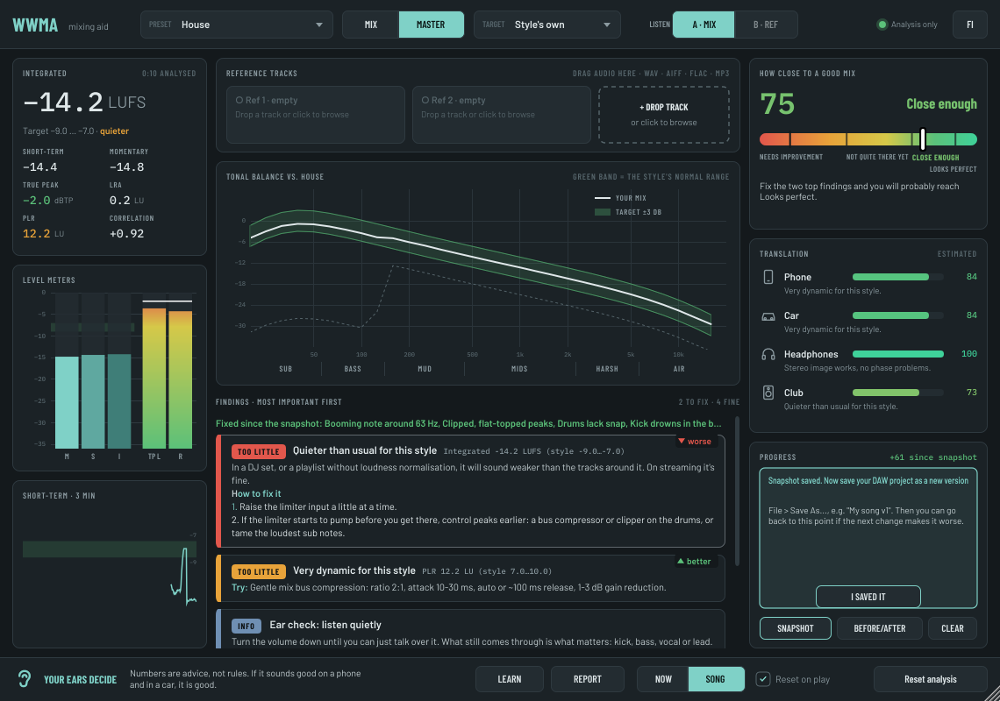
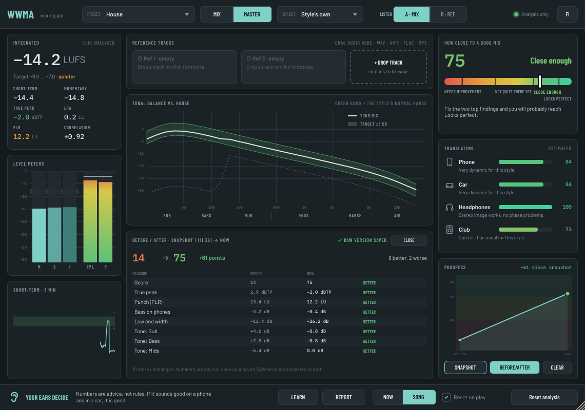
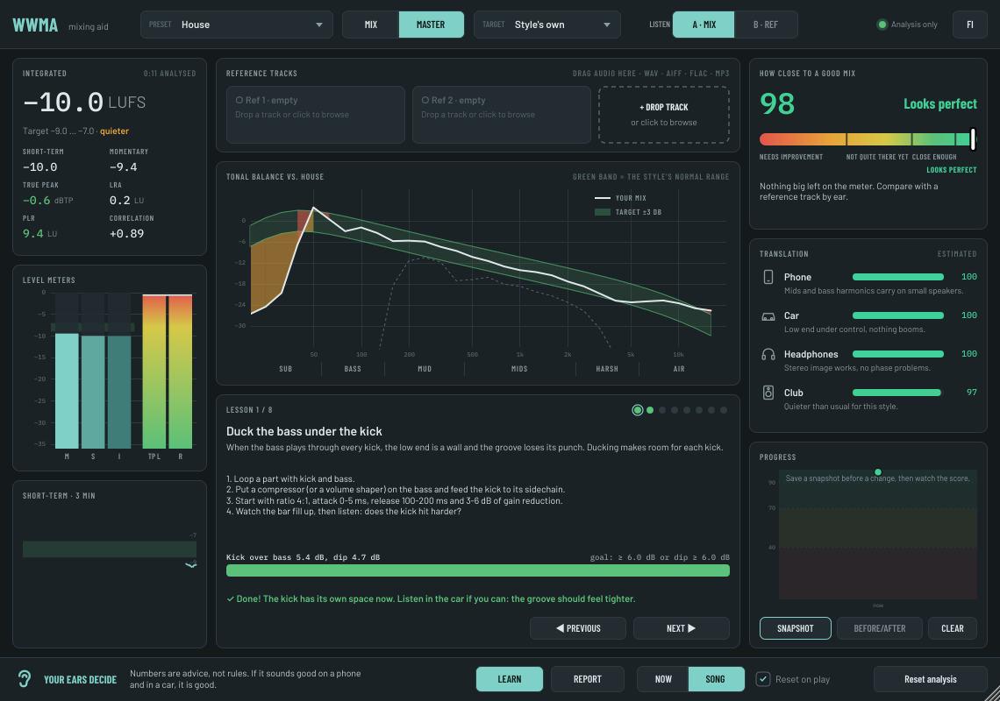
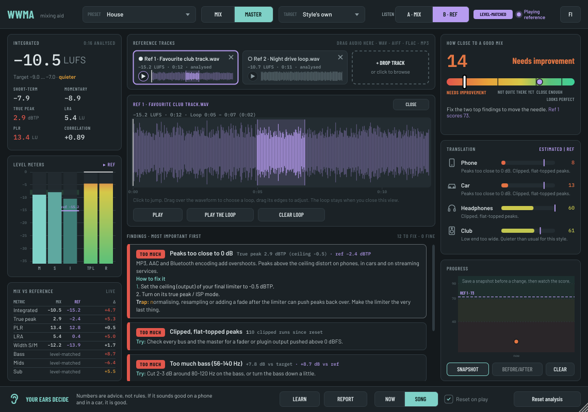
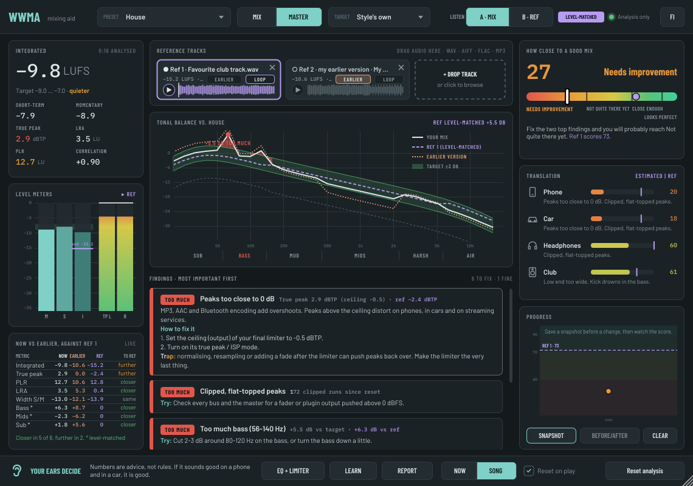
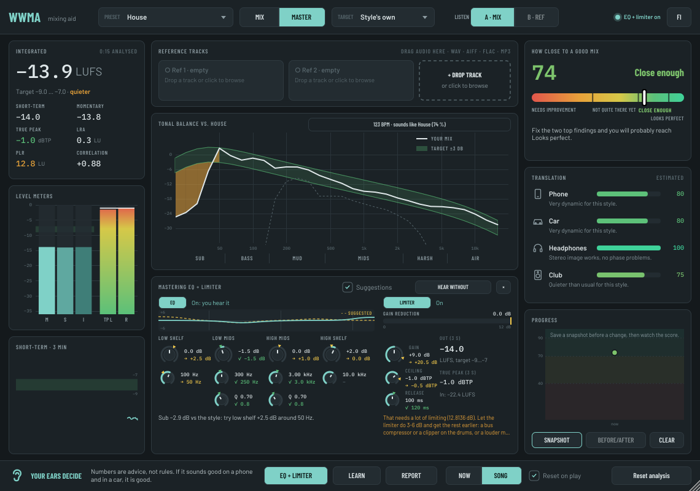

# WWMA manual

WWMA (Washable and Withstanding Mixing Aid) listens to your master bus and teaches you what to change. It never changes your sound by itself. It changes what you hear only when you choose **B · REF** to hear a reference track, or when you turn on its own mastering EQ or limiter (section 9). Even then it never turns a knob for you.

> **Heads-up: WWMA is 100 % vibe coded.** It was built entirely with an AI coding assistant, not by a seasoned plugin developer. Install and use it at your own risk: there is no warranty, and it may have bugs. It was made in good faith, in the hope that it helps someone make better mixes.

**Your ears decide.** Every number in WWMA is advice, not a rule. If the mix sounds good on a phone and in a car, it is good.

## 1. Setting up

1. Put WWMA **last** on the master bus, after your limiter. (Or use WWMA's own EQ and limiter as the last stage, see section 9.)
2. Pick a **Preset** for your style.
   - Electronic styles come first in the list.
   - Not sure which? Play the song for 15 seconds. WWMA suggests one (see section 4).
3. Choose **MIX** or **MASTER**.
   - Use **MIX** while you are still mixing. Loudness and the ceiling are not judged; you get headroom advice instead.
   - Use **MASTER** when you are mastering. Everything is judged.
4. Pick a loudness **Target**.
   - The style's own target is a good start.
   - If the song only goes to streaming, −14 LUFS is plenty.
5. Choose a time window:
   - **SONG** looks at everything since the last reset. Play the whole song.
   - **NOW** looks at the last 3 seconds. Loop a part and tweak while you watch.
6. Turn on **Reset on play** to start a new measurement every time the DAW starts playing.

### The standalone app

WWMA also runs on its own, without a DAW: **WWMA Mixing Aid** in Applications (macOS), in the Start menu (Windows), or the `WWMA Mixing Aid` program in the Linux zip. It is handy for trying out reference tracks quickly: drag them onto the window, compare their numbers and play them with ▶ or **B · REF** (there is no DAW transport, so B plays the reference right away). The audio interface input is not used. Your own song is a file: load it with **LOAD YOUR MIX** at the bottom right (or drop it on that button), play it with ▶ and jump around with the thin bar under the buttons. Reference tracks go in the boxes at the top. Each reference remembers where you left it when you switch between them, and a loop starts from its marked point.

While **B · REF** plays, the loudness, tonal balance, findings, score and translation panels show the reference's numbers, and your mix becomes the dashed comparison line and marker. Switch back to **A · MIX** to see your own again.

## 2. The screen

| Panel | What it shows |
|---|---|
| Integrated | Integrated loudness (LUFS), short-term, momentary, true peak, LRA, PLR and correlation. |
| Level meters | Mid, side and integrated level, and the true peak per channel. The green band is the target. |
| Short-term · 3 min | Loudness history. When a reference is loaded, the **Mix vs reference** table is shown here instead. |
| Reference tracks | Up to two reference tracks, each with its waveform. Click a waveform to jump. |
| Tonal balance | Your mix (white) against the style's corridor (green), in plain-named ranges: sub, bass, mud, mids, harsh and air. Red means too much; orange means too little. |
| Findings | At most four things to fix, most important first. Click a card for the reason, every step and the common trap. |
| How close to a good mix | Score 0–100: Needs improvement, Not quite there yet, Close enough, Looks perfect. |
| Translation | How the mix should hold up on a phone, in a car, on headphones and in a club. |
| EQ + Limiter | The mastering EQ and limiter, opened with the **EQ + Limiter** button at the bottom. It takes the place of the findings while it is open. See section 9. |
| Progress | Save a snapshot before a change. The cards then show what got better or worse, the chart tracks your score, and **Before/after** compares every meter. See section 5. |

## 3. Every check, explained

Each finding is **clearly** or **slightly** off. The score drops more for the clear ones and for the checks that matter most on small speakers.

### Loudness and peaks

| Finding | Fires when | First thing to try |
|---|---|---|
| Louder than needed | Integrated loudness is above the style's range (MASTER only). | Push the limiter less. Streaming turns loud masters down anyway. |
| Quieter than usual for this style | Below the style's range (MASTER only). | Raise the limiter input a little at a time. |
| Peaks too close to 0 dB | True peak is above the ceiling (MASTER only). | Set the limiter ceiling to −1 dBTP and turn on its true-peak mode. |
| Over-compressed: punch is gone | PLR (peak to loudness) is below the style's range. | Less limiting, and a slower attack on bus compressors. |
| Very dynamic for this style | PLR is above the style's range. | Gentle bus compression, or ride the quiet parts up. |
| Big level jumps between sections | Loudness range (LRA) is above the style's maximum. | Automate the quiet sections up, or the loud ones down. |
| Clipped, flat-topped peaks | Samples stuck at full scale, three or more in a row. | Lower the level before the limiter. |
| No headroom left for mastering | Peaks above −1 dBTP while in MIX mode. | Pull the master fader down so peaks sit around −6 to −3 dBFS. |
| Mixing into a limiter? | The mix is already louder than −11 LUFS in MIX mode. | Bypass the master limiter while you balance. |
| DC offset | The waveform sits off centre (whole song). | A DC filter or a 10–20 Hz high-pass on the track that causes it. |

### Low end

| Finding | Fires when | First thing to try |
|---|---|---|
| Kick drowns in the bass | The kick rises too little above the bass level just before it. | Sidechain ducking: ratio 4:1, attack 0–5 ms, release 100–200 ms, 3–6 dB. |
| Bass will disappear on phones | Too little 90–280 Hz compared with the sub. | Saturation on the bass, or a layer an octave up. |
| Low end too wide | Too much side signal below 140 Hz. | Make everything below about 120 Hz mono. |
| Booming note | One low band sticks out of its neighbours by more than 7 dB. | A narrow cut (Q 4–8) or a dynamic EQ on that note. |
| Rumble below 30 Hz | Too much energy at 20–30 Hz. | High-pass the bass and kick at 25–30 Hz. |

### Tone

| Finding | Fires when | First thing to try |
|---|---|---|
| Too much / too little (sub, bass, mud, mids, harsh, air) | A broad range is outside the style's corridor, after level matching. | Cut before you boost. Find what masks the missing part. |
| Piercing peak | One band at 2–4 kHz sticks out. | Find the instrument and cut it narrowly there. |
| Sharp "s" sounds and hiss | A narrow bump at 5–10 kHz above both neighbours. | A de-esser on the vocal and on its reverb sends. |
| Hole in the spectrum | One band is far below its neighbours. | Check for over-cutting EQs, or fill the gap with an instrument. |

### Stereo

| Finding | Fires when | First thing to try |
|---|---|---|
| Phase problems | Correlation below 0.3. | Look for wideners, Haas delays and flipped layers. |
| Gets quieter in mono | Summed to mono, a loud part of the spectrum (140 Hz–5 kHz) drops more than about 4 dB: a wide synth or lead that partly cancels. Also shown under the low end width as "bass −x dB in mono". | Check the widener or chorus on that part, narrow it, or keep a mono core and widen only a copy. |
| Very wide stereo image | Side is close to mid overall. | Less widening; keep important parts in the centre. |
| Narrow, almost mono mix | Hardly any side signal. | Pan support parts and add a little stereo reverb. |
| Top end mostly on the sides | Above 4 kHz the side is louder than the mid. | Put something bright in the centre and widen less. |
| Mix leans to one side | Left and right differ by more than 1.5 dB. | Check panning and any one-sided effects. |

### Drums

Drum advice only appears when there are drums: regular kicks or a clear beat.

| Finding | Fires when | First thing to try |
|---|---|---|
| Drums lack snap | Snare and hat hits barely stand out of the 1.5–6 kHz region. | A slower attack on bus compressors, or a transient shaper on the snare. |
| Drum hits poke out too much | Very spiky snare and hat hits. | Turn them down 1–2 dB, or glue the drum bus. |

### Listening tips

A rotating tip (every 30 seconds) reminds you of habits that don't show on a meter: listen quietly, check in mono, check on your phone, take breaks, match loudness before comparing, don't decide in solo.

## 4. Style suggestion

After about 15 seconds of music, WWMA guesses which preset the song sounds closest to. The guess appears at the top of the tonal panel:

> Sounds like Drum & Bass (40 %) · 174 BPM - use it?

Click it to switch to that preset. **Nothing changes unless you click.** When the guess agrees with your preset, the chip just says so.

How it works, without any machine learning:

- **Tempo** comes from how regularly drum hits repeat. Half-time and double-time are understood, so drum & bass heard at 87 BPM still counts as 174.
- **Tonal balance** is compared with each preset's corridor.
- **Loudness range** counts too: a very dynamic song is unlikely to be a club style.

The percentage is shared between close relatives. "House 72 %" means the house family (House, Deep, Tech, Afro, Minimal) together.

Limits:

- Styles at the same tempo (techno and UK garage at 132, for example) are easy to mix up.
- Your own choice and your ears win.

## 5. Snapshots and before/after

1. Press **Snapshot** before you change something. WWMA stores the score and every key number.
2. The progress panel then asks you to **save your DAW project as a new version** (File > Save As..., e.g. "My song v3"). That way you can always go back to the mix before the change.
3. Press **I saved it** once you have. The reminder stays until you do, and the snapshot remembers that a DAW version exists (✓ in the chart).
4. Make your change and play the same part again. The tonal balance view shows the snapshot's curve as a faint teal **ghost line**, and the gap between it and your mix is filled in blue, so you see at a glance how far the tone has moved. Click **Difference** in the legend to turn the fill off or on.
5. Press **Before/after**. A table shows every number before and now, marked **BETTER**, **WORSE** or **=**, with the better ones first.

Snapshots are saved with your DAW project.

## 6. Learning mode

Press **Learn** to get short, hands-on tasks instead of the findings. Each lesson says why it matters, what to do step by step, and shows a bar that fills up as you get closer. The lesson is done when the goal holds for 3 seconds of music. Loop a part and tweak while you watch (lessons always look at the last 3 seconds).

| Lesson | Done when |
|---|---|
| Duck the bass under the kick | The kick rises clearly above the bass, or the bass dips clearly after each kick (sidechain). |
| Make the low end mono | Hardly any side signal below 140 Hz. |
| Make the bass heard on a phone | The bass harmonics (the part phones can play) are loud enough. |
| Clear the mud | 200–450 Hz is no more than 1 dB above the style's target. |
| Let the drums through | Snare and hats stand out of the 1.5–6 kHz region. |
| Make it mono-safe | Nothing important gets quieter in mono, and correlation is at least 0.5. |
| Leave headroom for mastering | The true peak sits between −6 and −3 dBTP. |
| Reach the style's loudness without squashing | Loudness is in the style's range and the punch (PLR) is still there. |

Finished lessons get a filled dot. Your progress is saved with the project. Lessons never touch the sound: you do the work.

## 7. Mix report

Press **Report** to save a report as a Markdown file (it opens in any text editor, and GitHub or Obsidian show it nicely). It holds:

- the score and the playback estimates
- what to fix, with the reasons and steps
- every number, and the reference track's numbers if one is loaded
- your snapshots, and whether a DAW version was saved for each
- **Since the previous report**: when an earlier report is in the same folder, what got better or worse since then.

A JSON copy is saved next to it so that later reports can compare. Keep the reports in one folder per song (the default is Documents/WWMA Reports). See an [example report](example-report.md).

## 8. Reference tracks

Drag a track you like (WAV, AIFF, FLAC, MP3 or OGG; also M4A on macOS and Windows) onto the window, or click a slot to browse. It is analysed once in the background. Then:

- Its tonal curve appears as a purple dashed line, level-matched to your mix.
- The **Mix vs reference** table shows the differences.
- Every finding also shows the reference's value.
- Choose the **Reference track** preset to use the reference as the target.
- **B · REF** plays the reference instead of your mix, at the same loudness and following your song position. This is the only time WWMA changes what you hear, and the top bar turns purple while it does.

Playing the reference inside WWMA:

- **▶ / ❚❚** next to the small waveform plays and pauses the reference on its own, even while the DAW is stopped. Pause takes you back to your mix and keeps the position.
- **Click or drag on the small waveform** to jump.
- **Click the track's name or numbers** for a big view. There you can click to jump, **drag over the waveform to choose a loop**, drag the loop's edges to adjust it, and use **Play the loop** or **Clear loop**.
- Close the big view and the loop stays: it is shaded on the small waveform, and ▶ plays only that part, over and over. The loop is saved with your project.

### Your earlier version against a real reference

Comparing your mix only with an older bounce of your own song tells you what changed, not whether it got better. So load both: a record you like in one slot and your earlier bounce in the other, then press the small **EARLIER** chip on the earlier bounce (or **My earlier version** in the big view). The slot then reads "my earlier version" and the mark is saved with your project.

With one earlier version and one real reference loaded, the table becomes **Now vs earlier**:

- three columns side by side: **Now** (your mix), **Earlier** and **Ref**, for loudness, true peak, PLR, LRA and width;
- the three tonal ranges that differ most, level-matched, as the difference to the reference, now and in the earlier version;
- **To ref** on every row: *closer* (green) when your mix is now nearer the reference than the earlier version was, *further* (orange) when it moved away, *same* otherwise;
- a summary line, for example "Closer in 6 of 8, further in 1".

The tonal chart draws the earlier version as an orange dotted line next to the reference's dashed one, so you can see which one your curve sits nearer. The reference is still the target: findings, the score and **B · REF** use the selected reference as before. Select the earlier version (click its name) to listen to it with B; the table then warns that it is not a target.

## 9. Mastering EQ and limiter

Press **EQ + Limiter** at the bottom to open the panel. It has a four-band EQ and a true peak limiter, enough to finish a master without another plugin. **WWMA suggests values, you turn the knobs.** Nothing here moves by itself.

**The knobs**

| Stage | Knob | What it does |
|---|---|---|
| EQ | Low shelf: gain, frequency | Lifts or lowers everything below the frequency (sub and bass). |
| EQ | Low mids: gain, frequency, Q | A bell for the 60 Hz – 1.5 kHz region, usually mud around 200–400 Hz. |
| EQ | High mids: gain, frequency, Q | A bell for 400 Hz – 12 kHz: the mids, or harshness around 2–5 kHz. |
| EQ | High shelf: gain, frequency | Air: lifts or lowers everything above the frequency. |
| Limiter | Gain | How much louder the mix goes into the limiter. This sets the final loudness. |
| Limiter | Ceiling | The highest true peak let out, in dBTP. |
| Limiter | Release | How fast the limiter lets go after a peak. |

- Both stages are **off** by default. The **EQ** and **LIMITER** buttons turn them on and off. They fade in and out in 30 ms, so switching while playing doesn't click.
- Drag a knob up/down or sideways. Double-click a gain knob to reset it to 0 dB. Every knob is also a normal plugin parameter, so your DAW can automate it.
- The top bar says what WWMA does to the sound right now: *Analysis only*, *EQ on*, *Limiter on* or *EQ + limiter on*.
- The limiter looks 1.5 ms ahead, so WWMA reports a fixed delay of about 1.7 ms (80 samples at 48 kHz). Your DAW compensates it. With both stages off, the sound passes through bit for bit, just delayed.
- The limiter finds peaks on a 4× oversampled signal (like the true peak meter), so inter-sample peaks stay under the ceiling too.

**The suggestions**

- WWMA measures the mix **before** the EQ and limiter, and works out each suggestion from that, the preset and the loudness target. The meters, findings and score measure what comes **out**.
- Each knob shows its value and, under it, the suggestion: **→ +2.0 dB** in yellow, or **✓** in green when the knob is close enough. A small marker on the knob's ring shows the same spot. Hover a knob for the reason.
- The small curve shows your EQ (solid) and the suggested EQ (dashed).
- EQ suggestions are gentle: about 80 % of the gap, never more than 4 dB. A range that is clearly off gets a note that it's better fixed in the mix.
- **Gain** is worked out so that the output lands in the middle of the target range. The yellow mark on the gain reduction meter shows how much limiting that should take. Over about 8 dB, WWMA suggests getting the rest earlier in the chain (a bus compressor, a clipper, or a louder mix).
- **Ceiling** follows the style and target (for example −1 dBTP for streaming).
- **Release** is about a 16th note at the song's tempo, so the limiter breathes in time. Without a clear tempo it's 100 ms.
- In **MIX** mode the limiter is suggested off: limiting while mixing hides balance problems.
- Untick **Suggestions** to hide them all. The setting is saved with the project.

**Hear without** plays your mix without the EQ and limiter, at the same loudness as with them (the top bar turns yellow while it does). Use it to check that the chain makes the sound better and not just louder. Louder always sounds better for a moment.

The mix report lists your EQ and limiter settings next to the suggestions.

## 10. Good habits

1. Balance first, plugins later: kick and bass, then snare, then the lead, then the rest.
2. Decide who owns the sub (kick or bass), and keep everything below about 120 Hz mono.
3. Clear the mud: 200–400 Hz builds up when many full sounds play together.
4. Let the drums through: sidechain the bass, and use a slower attack on bus compressors.
5. Keep important parts in the centre, and check in mono.
6. Master last: leave headroom while mixing, then set the limiter ceiling to −1 dBTP. Compare with **Hear without** before you decide.

## 11. Remember

- The score tells you how close you are to a typical master in the style. It does not tell you whether the song is good.
- The presets are educated guesses from common practice. The most accurate target is a reference track you like.
- Always check on a phone and in a car before you call it done.
