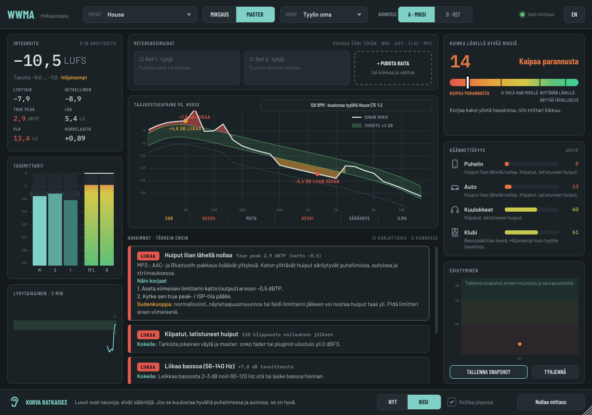
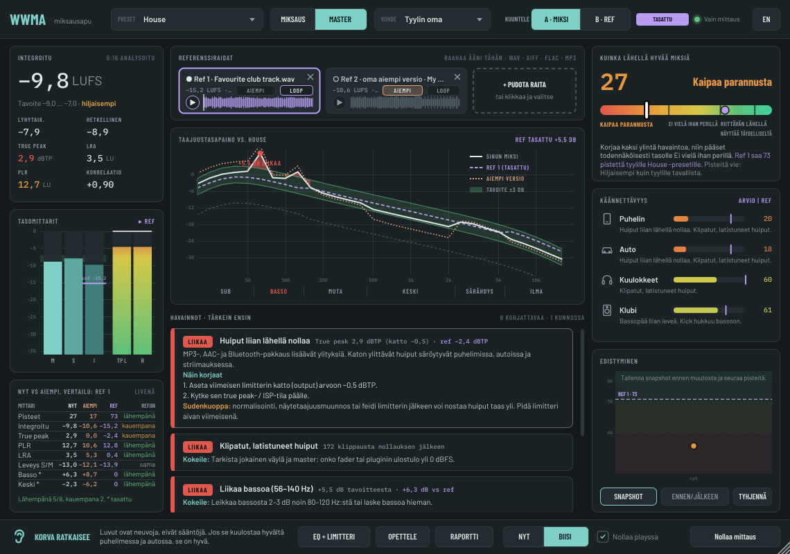
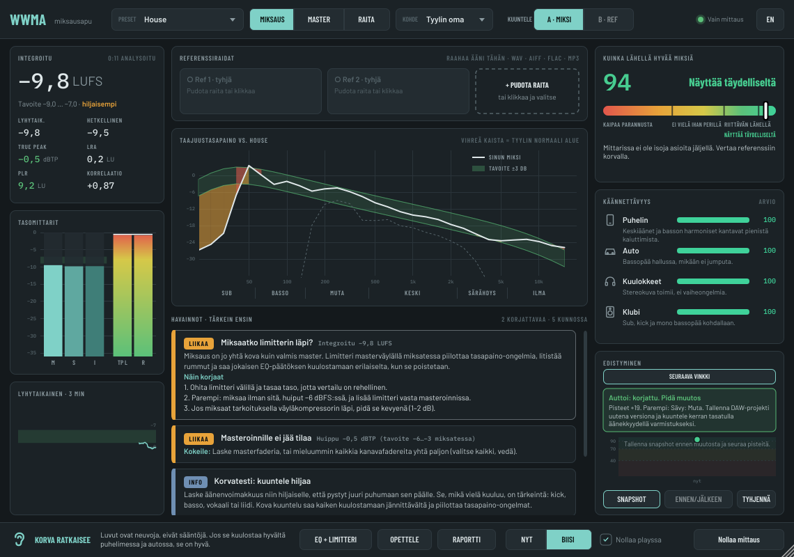
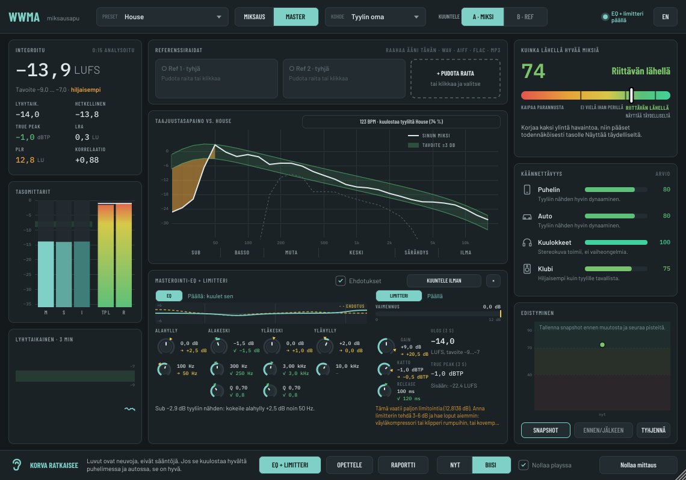
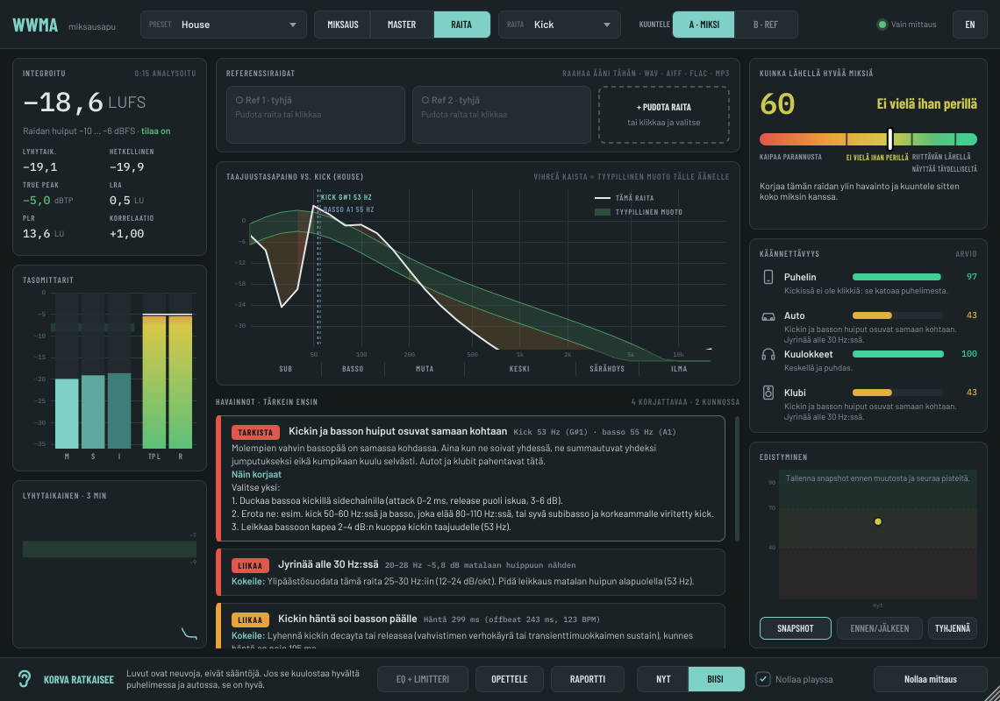
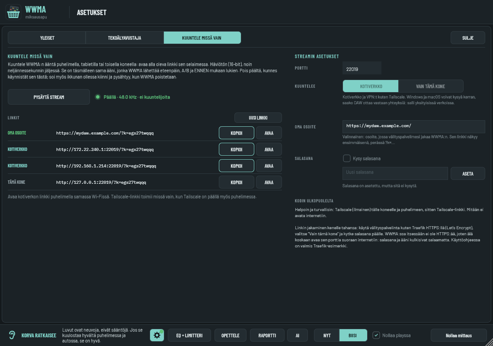

# WWMA-opas: miksaa paremmin, opi samalla

> **Huom: WWMA on 100 % vibe-koodattu**, eli tehty kokonaan tekoälyavustajan kanssa. Asennus ja käyttö omalla vastuulla, eikä takuuta ole. Se on tehty hyvässä uskossa ja siinä toivossa, että siitä on jollekin hyötyä.

WWMA ei korjaa mitään puolestasi, eikä se koskaan käännä nuppia ilman klikkaustasi (ja jokaisen sellaisen klikkauksen voi perua). Se kuuntelee miksauksesi, kertoo selkokielellä, mitä on selvästi tai vähän liikaa tai liian vähän, ja neuvoo, miten korjaat sen itse. Tavoite on, että ajan mittaan et tarvitse sitä enää.

**Korva ratkaisee.** Luvut ovat neuvoja, eivät sääntöjä. Jos se kuulostaa hyvältä puhelimessa ja autossa, se on hyvä.

## 1. Käyttöönotto

1. Laita WWMA masterväylän **viimeiseksi** pluginiksi, limitterin jälkeen. (Tai käytä WWMA:n omaa EQ:ta ja limitteriä viimeisenä vaiheena, ks. luku 7.)
2. Valitse **Preset**: oma tyylisi. Elektroniset ovat listan alussa. Jos et ole varma, soita kappaletta 15 sekuntia: WWMA ehdottaa lähintä tyyliä (ks. alla).
3. Valitse **MIX**, kun vielä miksaat. Silloin äänekkyyttä ja huippuja ei arvioida, vain tasapainoa, leveyttä, dynamiikkaa ja rumpuja. Valitse **MASTER**, kun masteroit.
4. Valitse **Target** eli äänekkyystavoite. Tyylin oma on hyvä alku. Jos kappale menee vain suoratoistoon, −14 LUFS riittää.
5. Soita koko kappale **BIISI**-tilassa tai looppaa työstettävää kohtaa **NYT**-tilassa. Kielen vaihdat oikean yläkulman FI/EN-napista.

**Standalone-sovellus:** WWMA toimii myös ilman DAW:ia. Sen löydät nimellä **WWMA Mixing Aid** macOS:n Ohjelmat-kansiosta, Windowsin Käynnistä-valikosta tai Linux-zipistä. Sillä on kätevä kokeilla referenssibiisejä nopeasti: raahaa kappaleet ikkunaan, vertaa lukemia ja soita ▶-napilla. Koska DAW:in transporttia ei ole, referenssi soi vain oman ▶-nappinsa kautta: **REF** vain valitsee, mitä kuulet, ja referenssi muistaa soittotilansa ja kohtansa, kun vaihdat MIKSI- tai ENNEN-ääneen ja takaisin. Äänikortin sisääntuloa ei käytetä. Oma biisisi on tiedosto vasemman alakulman soittimessa: lataa se **LATAA MIKSI** -napilla (tai pudota se soittimeen) ja soita ▶-napilla. Soitin näyttää biisin nimen, kohdan (`0:42 / 3:15`) ja aaltomuodon, soitettu osa korostettuna: klikkaa tai vedä aaltomuodosta hypätäksesi, ja vie hiiri sen päälle nähdäksesi, mihin aikaan klikkaus hyppää. Referenssit menevät ylälaatikoihin. Jokainen referenssi muistaa kohdan, johon se jäi, kun vaihdat niiden välillä, ja loop alkaa merkitystä kohdasta.

## 2. Näytön osat

- **Integroitu äänekkyys** (vasen ylhäällä): kappaleen keskimääräinen äänekkyys LUFS-yksikössä sekä short-term, momentary, true peak, LRA, PLR ja korrelaatio.
- **Tasomittarit**: M, S ja I sekä true peak kanaville L ja R. Vihreä kaista on tavoitealue.
- **Taajuustasapaino**: miksauksesi (valkoinen) tyylin käytävää (vihreä) vasten. Punainen tarkoittaa liikaa, oranssi liian vähän. Alueiden nimet ovat SUB, BASSO, MUTA, KESKI, SÄRÄHDYS ja ILMA.
- **Havainnot**: enintään neljä korjattavaa kerrallaan, tärkein ensin. "Kokeile:" kertoo ensimmäisen askeleen. Klikkaa korttia, niin näet syyn, kaikki askeleet ja tyypillisen **sudenkuopan**.
- **Kuinka lähellä hyvää miksiä**: sanallinen taso: Kaipaa parannusta, Ei vielä ihan perillä, Riittävän lähellä. Siitä eteenpäin mittari astuu sivuun ja korva päättää loput. **0-100**-nappi näyttää numeron (oletuksena pois, ks. luku 4).
- **Käännettävyys**: arvio siitä, miten miksaus kestää puhelimessa, autossa, kuulokkeilla ja klubilla.
- **Edistyminen**: tallenna snapshot ennen muutosta. Kortit näyttävät sen jälkeen, mikä parani tai huononi, **Ennen/jälkeen** vertaa jokaista lukemaa, ja **Versiot** listaa levylle tallennetut ENNEN-nauhoitukset. Katso luku 4.
- **Kuuntele: Miksi · Ennen · Ref**: **Miksi** on miksisi. **Ennen** soittaa miksiä sellaisena kuin se oli viimeisessä snapshotissa, samasta kohdasta biisiä. **Ref** soittaa referenssiraitaa. Molemmat tasataan samaan äänekkyyteen.
- **Mono-tarkistus**: varoittaa, jos basso tai leveä syna hiljenee, kun miksi summataan monoksi (klubi, puhelin ja moni Bluetooth-kaiutin soittavat monona).
- **Referenssiraidat**: raahaa ikkunaan kappale, josta pidät (WAV, AIFF, FLAC tai MP3). Plugin analysoi sen kerran, jonka jälkeen:
  - sen käyrä näkyy violettina katkoviivana
  - "Miksi vs referenssi" -taulukko näyttää erot
  - jokaisessa havainnossa näkyy myös ero referenssiin.

  **A/B**-kytkin soittaa referenssiä miksauksesi tilalla samalla äänekkyydellä. Se on ainoa tilanne, jossa WWMA muuttaa kuulemaasi, ja silloin yläpalkin merkki muuttuu violetiksi.

  Referenssin soittaminen pluginissa:
  - **▶ / ❚❚** pienen aaltomuodon vieressä soittaa ja pysäyttää referenssin, vaikka DAW olisi pysähdyksissä. Tauko palauttaa miksisi ja muistaa kohdan.
  - **Klikkaa tai raahaa pientä aaltomuotoa** kelataksesi.
  - **Klikkaa raidan nimeä tai lukemia**, niin aukeaa iso näkymä. Siinä voit hypätä klikkaamalla, **raahata aaltomuodon yli valitaksesi loopin**, säätää loopin reunoja raahaamalla sekä käyttää **Soita looppi**- ja **Poista looppi** -nappeja.
  - Kun suljet ison näkymän, looppi jää voimaan: se näkyy pienessä aaltomuodossa, ja ▶ soittaa vain sitä kohtaa yhä uudelleen. Looppi tallentuu projektin mukana.

  **Oma aiempi versio vs oikea referenssi.** Jos vertaat miksiäsi vain oman biisisi vanhempaan versioon, näet mikä muuttui, mutta et sitä, parantuiko se. Lataa siksi molemmat: yhteen paikkaan kappale, josta pidät, ja toiseen aiempi bouncesi. Paina aiemman version pientä **AIEMPI**-nappia (tai isossa näkymässä **Oma aiempi versio**). Merkintä tallentuu projektin mukana.

  Kun ladattuna on aiempi versio ja oikea referenssi, taulukko näyttää **Nyt vs aiempi**:
  - sarakkeet **Nyt**, **Aiempi** ja **Ref** rinnakkain: äänekkyys, true peak, PLR, LRA ja leveys
  - kolme eniten eroavaa taajuusaluetta tasot tasattuina, erona referenssiin nyt ja aiemmassa versiossa
  - jokaisella rivillä **Refiin**: *lähempänä* (vihreä), kun miksisi on nyt lähempänä referenssiä kuin aiempi versio oli, *kauempana* (oranssi), kun se on loitonnut, muuten *sama*
  - yhteenveto, esimerkiksi "Lähempänä 6/8, kauempana 1".

  Taajuustasapainossa aiempi versio näkyy oranssina pisteviivana referenssin katkoviivan vieressä. Tavoite on edelleen referenssi: havainnot, pisteet ja **B · REF** käyttävät valittua referenssiä. Jos valitset aiemman version (klikkaa nimeä) kuunnellaksesi sitä B:llä, taulukko muistuttaa, ettei se ole tavoite.

  

## 3. Tyyliehdotus

Noin 15 sekunnin jälkeen WWMA arvaa, mitä presettiä kappale muistuttaa eniten, ja näyttää sen taajuustasapainon yläreunassa, esimerkiksi "Kuulostaa tyyliltä Drum & Bass (40 %) · 174 BPM – vaihdetaanko?". Klikkaa, niin preset vaihtuu. **Mikään ei muutu, ellet klikkaa.**

Arvaus perustuu kolmeen asiaan, eikä siinä ole koneoppimista:

- **Tempo** lasketaan siitä, kuinka säännöllisesti rumpuiskut toistuvat. Half-time ymmärretään, joten 87 BPM:nä kuuluva drum & bass lasketaan 174:ksi.
- **Taajuustasapainoa** verrataan jokaisen presetin käytävään.
- **Dynamiikka** vaikuttaa myös: hyvin dynaaminen kappale tuskin on klubityyliä.

Prosentti jaetaan lähisukulaisten kesken: "House 72 %" tarkoittaa koko house-perhettä (House, Deep, Tech, Afro, Minimal). Samassa tempossa olevat tyylit, kuten techno ja UK garage 132 BPM:ssä, menevät helposti sekaisin, joten oma valintasi ja korvasi ratkaisevat.

## 4. Snapshotit, ennen/jälkeen ja DAW-versiot

1. Paina **Snapshot** ennen kuin muutat jotain. WWMA tallentaa pisteet ja kaikki tärkeät lukemat.
2. Edistyminen-paneeli pyytää sen jälkeen **tallentamaan DAW-projektin uutena versiona** (File > Save As..., esim. "Biisi v3"). Näin pääset aina takaisin muutosta edeltävään miksiin.
3. Kun olet tallentanut, kuittaa painamalla **Tallensin**. Muistutus pysyy näkyvissä siihen asti, ja snapshot muistaa, että sille on DAW-versio (✓ kaaviossa).
4. Tee muutos ja soita sama kohta uudestaan. Taajuustasapainossa näkyy snapshotin käyrä himmeänä turkoosina **haamukäyränä**, ja ero sen ja miksisi välillä on täytetty sinisellä, joten näet heti, kuinka paljon sointi on muuttunut. Selitteen **Ero**-ruudusta saat täytön pois päältä tai takaisin.
5. Paina **Ennen/jälkeen**: taulukko näyttää jokaisen lukeman ennen ja nyt, merkittynä PAREMPI, HUONOMPI tai =.

### ENNEN: kuule miksi sellaisena kuin se oli, ilman exporttia

VST-, AU- tai CLAP-plugin ei näe DAW:n kumoa-historiaa (ei myöskään Studio Onen Historya), eikä se voi muuttaa projektiasi. Siksi WWMA nauhoittaa oman ulostulonsa: se on masterin viimeisenä, joten se kuulee täsmälleen saman kuin sinä.

- Kun DAW soittaa, WWMA nauhoittaa ulos lähtevän äänen sekunti kerrallaan **biisin kohdan mukaan**. Kun soitat kohdan uudelleen, uusi korvaa vanhan, joten jokaisesta soitetusta kohdasta on aina uusin ääni.
- **Snapshot** jäädyttää nauhoituksen **ENNEN**-ääneksi.
- Tee muutos ja paina yläpalkista **ENNEN**: kuulet miksin sellaisena kuin se oli, siitä kohdasta, jossa DAW:n soittopää on. Se seuraa looppeja, hyppyjä ja koko biisiä. **MIKSI** soittaa nykyisen. Molemmat soivat samalla äänekkyydellä, jottei kovempi voita vain kovuudellaan.
- **Koko biisi**: soita se kerran läpi ennen snapshotia tai **exporttaa kerran**. Export kulkee myös WWMA:n läpi, joten yksi bounce täyttää ENNEN-äänen koko biisille sekunneissa. Sen jälkeen vertailua varten ei tarvitse bouncata.
- ENNEN-napin alla oleva ohut palkki näyttää, mitkä kohdat biisistä on nauhoitettu (kirkkaampi: uusimmasta snapshotista, himmeämpi: vanhemmasta). Kohdassa, josta ei ole ääntä, miksi soi edelleen ja tila kertoo sen.
- Oletus on, että sovitus pysyy samana. Jos siirrät osia ajassa, ENNEN soittaa vanhaa sovitusta siitä aikakohdasta.
- Enintään 15 minuuttia biisiä. Muisti on rajattu noin 230 megatavuun ENNEN-äänelle ja käynnissä olevalle nauhoitukselle yhteensä, joten 96 kHz:llä mahtuu noin puolet vähemmän. ENNEN ei koskaan soi exporttiin.

### Versiot levyllä, ja WWMA lisätty projektiin uudelleen

Jokainen snapshot tallentaa ENNEN-äänen myös 24-bittisenä FLACina WWMA:n omaan kansioon, ei DAW-projektiin:

- Windows: `%APPDATA%\WWMA\Projects`
- macOS: `~/Library/Application Support/WWMA/Projects`
- Linux: `~/.config/WWMA/Projects`

**Versiot** (edistymispaneelissa) listaa ne: **Käytä** lataa version ENNEN-ääneksi, **Nimeä** antaa nimen (nimettyjä ei koskaan poisteta automaattisesti), **Poista** siirtää roskakoriin. Istunto säilyttää 10 nimeämätöntä versiota; vanhemmat siirtyvät roskakoriin. Paneeli listaa myös kansion muut istunnot kokoineen jatkettavaksi tai poistettavaksi, ja **Avaa kansio** avaa sen.

WWMA pitää siellä myös koko tilansa (referenssit ja mistä ne ladattiin, loopit, snapshotit, asetukset). Jos poistat WWMA:n projektista ja lisäät sen uudelleen, esimerkiksi päivityksen takia, uusi WWMA alkaa tyhjänä ja kysyy **Jatketaanko aiemmasta istunnosta?**, saman tyypin (master, kick, basso) istunnot ensin. Mitään ei palauteta ennen kuin valitset; **Aloita alusta** jättää vanhan rauhaan. Vinkki: kun päivität projektin ollessa kiinni (sulje DAW, vaihda plugin, avaa projekti), kaikki säilyy ilman tätä vaihetta, koska DAW antaa tallennetun tilan uudelle versiolle.

### Numero on oletuksena piilossa

Pisteiden jahtaaminen voi viedä miksiä väärään suuntaan: mittari näkee vain sen, mitä se mittaa. Siksi mittari näyttää kolme sanallista tasoa, ja "Riittävän lähellä" -tasosta eteenpäin se sanoo, että korva päättää loput. Mittarin **0-100**-nappi tuo numeron, edistymiskaavion ja pisteet bannereihin takaisin. Asetus tallentuu projektiin.

Jos muutoksia kertyy snapshotin jälkeen paljon (kolme taajuusaluetta liikkunut 2 dB, mittari hypännyt 15 pistettä tai noussut samalla kun sävy siirtyi kauemmas referenssistä), edistymisbanneri pyytää kuuntelemaan ENNEN ja MIKSI ennen kuin jatkat.

### Auttoiko muutos? Soitot ja "Kokeile ylintä vinkkiä"

Vinkeistä on hyötyä vain, jos niiden noudattaminen oikeasti parantaa biisiä. WWMA tarkistaa sen puolestasi.

**Jokaista soittoa verrataan edelliseen.** Kun **Nollaa playssa** on päällä (oletus), WWMA aloittaa mittauksen alusta aina, kun painat play, ja samoin kun looppi palaa alkuunsa tai klikkaat soiton aikana toiseen kohtaan. Helpointa on siis loopata kohta, jota työstät: jokainen loopin kierros on uusi soitto. Kun soitat saman kohdan kuin äsken (aloitus enintään 2 sekunnin päässä samasta kohdasta), edistymispaneelin banneri kertoo muutaman sekunnin päästä **▲ Parempi kuin edellinen soitto (+6)**, **▼ Huonompi** tai **= Suunnilleen sama**, ja mitkä luvut liikkuivat: *Parempi: Sävy: Muta. Huonompi: Stereoleveys.* Kaava on siis yksinkertainen: muuta yhtä asiaa, soita sama kohta uudelleen, lue banneri. Eri kohtaa biisistä ei verrata, koska breakdownia ja droppia ei voi verrata reilusti.

**Kokeile ylintä vinkkiä** (nappi edistymispaneelissa) tekee tästä askel askeleelta etenevän oppitunnin omalla biisilläsi:

1. WWMA valitsee tärkeimmän havainnon ja näyttää siitä **yhden konkreettisen askeleen**, esimerkiksi *Pyyhkäise kapeaa korostusta 200–400 Hz:n välillä, etsi laatikkomainen kohta ja leikkaa siitä 2–4 dB.* Juuri soitetusta tulee ENNEN-ääni.
2. Teet muutoksen ja soitat saman kohdan uudelleen.
3. WWMA vertaa soittoa muutosta edeltävään ja kertoo, mitä mittari sanoo: auttoi, huononi tai ei selvää muutosta.
4. Sitten se kysyy korvaltasi: paina vuorotellen **ENNEN** ja **MIKSI** ja vastaa **Miksi parempi**, **Ennen parempi** tai **Ei eroa**. Korva voittaa:
   - Molemmat sanovat, että auttoi: **pidä muutos** ja tallenna DAW-projekti uutena versiona.
   - Mittari piti muutoksesta, mutta ENNEN kuulosti paremmalta: **korva voittaa, peru muutos**. Mittari näkee vain yhden asian; muutos vei luultavasti jotain muuta (lämpöä, iskua, tilaa). Tässä biisissä se voi olla valinta, joten havaintoa ei enää lasketa: ei pisteitä, muiden alapuolella, merkintä **Korvasi päätti**. Toisella kerralla WWMA ehdottaa, että lataat rakastamasi kappaleen ja käytät **Referenssiraita**-presetiä tavoitteena.
   - Pidit muutoksesta, vaikka mittari ei: pidä se, jos se kuulostaa paremmalta myös hiljaa ja puhelimesta.
   - **Ei eroa**: jos et itse kuule eroa, ei kukaan muukaan. Älä jatka siihen suuntaan.
5. **Seuraava vinkki** siirtyy uuteen tärkeimpään havaintoon. Edistymispaneelin **Tyhjennä** unohtaa snapshotit ja korvasi hylkäämät havainnot.

Jokainen havaintokortti kertoo myös **Kuuntele:** miltä ongelma kuulostaa, jotta opit kuulemaan sen, ja avattuna **Milloin voit jättää**: milloin kyse on tyylivalinnasta eikä virheestä.

Luvut eivät riipu siitä, kuinka kovaa soitat, mutta korvasi riippuvat: siksi ENNEN tasataan samaan äänekkyyteen (ja **Kuuntele ilman** tekee saman EQ:lle ja limitterille).

**Referenssiraidat** arvioidaan valmiina mastereina: niiden äänekkyys, true peak, klipatut huiput ja limitointi ovat masteroinnin valintoja, joten WWMA ei listaa niitä eikä vie niistä pisteitä. Vain miksi arvioidaan (sävy, bassopää, stereo, rummut). Oma **aiempi versiosi** arvioidaan kuten miksisi.

## 5. Opettelutila

**Opettele**-napista saat lyhyitä käytännön tehtäviä havaintojen tilalle. Jokainen kertoo miksi asia on tärkeä ja mitä tehdä, ja palkki täyttyy, kun lähestyt tavoitetta. Tehtävä on valmis, kun tavoite pysyy 3 sekuntia musiikkia. Looppaa kohtaa ja säädä samalla, kun katsot.

1. Duckaa basso kickin alle
2. Tee bassopäästä mono
3. Saa basso kuulumaan puhelimessa
4. Siivoa muta
5. Päästä rummut läpi
6. Tee miksistä monokelpoinen
7. Jätä tilaa masteroinnille
8. Saavuta tyylin äänekkyys litistämättä

Valmiit tehtävät saavat täytetyn pallon, ja edistys tallentuu projektin mukana. Oppitunnit eivät koske ääneen: sinä teet työn.

## 6. Miksausraportti

**Raportti**-napista tallennat raportin Markdown-tiedostona (aukeaa missä tahansa tekstieditorissa). Siinä on pisteet, käännettävyys, korjattavat asiat ohjeineen, kaikki lukemat, referenssin lukemat ja snapshotit. Viereen tallentuu JSON-kopio. Kun samassa kansiossa on aiempi raportti, uusi raportti kertoo **mikä parani tai huononi edellisen jälkeen**. Pidä siis yhden biisin raportit samassa kansiossa (oletus: Documents/WWMA Reports).

### Kuunteludata tekoälyavustajalle

Tekoälyavustaja ei kuule kappalettasi, mutta se osaa lukea lukuja ja kuvia. Siksi **Raportti** tallentaa raportin viereen kaksi tiedostoa lisää:

- **`... AI.md`**: kappale osa kerrallaan. WWMA pitää soiton aikana aikajanaa (äänekkyys, huiput, kuusi sävyaluetta ja leveys sekunti sekunnilta), jakaa kappaleen osiin kohdista, joissa ne muuttuvat, ja arvaa mikä kukin osa on (intro, nousu, drop, breakdown, outro). Tiedostossa on valmis kysymys liitettäväksi, osien taulukko, mitä osien välillä muuttuu (esim. "drop on vain 1 LU nousua kovempi"), aikajana ja lukujen tulkinta. Kun referenssi on ladattu, mukana ovat myös referenssin osat ja kummankin kovin drop rinnakkain.
- **`... AI.png`**: spektrogrammi kappaleesta (aika vasemmalta oikealle, matalat äänet alhaalla), sen alla äänekkyys, huiput ja leveys, ja osat merkittyinä. Referenssistä tallentuu vastaava `... AI reference.png`.

Aloita keskustelu tekoälyavustajan kanssa, liitä tiedostot ja liitä kysymys. Kysy sitten lisää, esim. "entä basso toisessa dropissa?". WWMA ei lähetä mitään minnekään: nämä ovat tavallisia tiedostoja koneellasi, ja sinä päätät mihin ne menevät.

### Kysy tekoälyltä suoraan WWMA:sta

Paina alareunan **AI**-nappia. Paneeli aukeaa spektrin ja havaintojen päälle. **Kysy** tallentaa raportin (samat tiedostot kuin **Raportti**) ja antaa sen **Asetukset → Tekoälyavustaja** -välilehdellä valitsemallesi avustajalle (Claude, Gemini tai ChatGPT). Asetukset aukeavat oikean alakulman rattaasta tai AI-paneelin **Asetukset**-napista. Tapoja on kolme:

- **Selain (ei avainta):** WWMA avaa palvelun selaimeen. Windowsissa tiedostot ovat leikepöydällä (Ctrl+V keskusteluun); muualla raporttikansio aukeaa ja vedät tiedostot mukaan. **Kopioi kysymys** laittaa kysymyksen leikepöydälle. WWMA ei lähetä itse mitään. Kopioi vastaus ja paina **Liitä vastaus**, niin saat Kokeile-napit.
- **Sovellus koneella (ei avainta):** WWMA ajaa koneelle asennetun **Claude Coden**, **Gemini CLI:n** tai **Codex CLI:n** omalla tilauksellasi kirjautuneena. Se saa lukea vain raporttikansiota. Asenna sovellus ja kirjaudu kerran päätteessä. Jotkin DAW:t eivät anna pluginien käynnistää muita ohjelmia: käytä silloin selainta tai avainta.
- **API-avain:** WWMA käyttää palvelun rajapintaa omalla avaimellasi (laskutus API-tilillesi). Paneelissa voi kysyä jatkokysymyksiä.

Claude Pro- tai Max-tilausta ei voi käyttää muista sovelluksista ilman avainta. Avaimettomat tavat Claudelle ovat selain ja Claude Code, joka käyttää tilaustasi.

- Vain raportti lähtee: luvut, kappaleen osat ja spektrogrammikuvat. **Ei koskaan ääntä.** Sovellus- ja API-tavat kysyvät ensin luvan (ruutu Asetuksissa).
- Asetukset ja avaimet ovat WWMA:n omassa kansiossa tällä koneella, eivät koskaan DAW-projektissa tai raportissa.
- Vastaus tallentuu raportin viereen (oletuksena `Tiedostot/WWMA Reports`) nimellä `... AI answer (Claude).md`, ehdotukset lopussa listana. Jatkokysymykset ja -vastaukset lisätään samaan tiedostoon. **Avaa tiedosto** avaa sen ja **Näytä kansiossa** näyttää sen; kansio näkyy myös asetusten Tekoälyavustaja-välilehdellä.
- Ehdotuksista (enintään kolme) tulee kortteja:
  - **Kokeile:** tee muutos itse ja soita sama kohta uudelleen. WWMA vertaa soittoa edelliseen ja kysyy sitten korvaltasi (ENNEN vai MIKSI), kuten "Kokeile ylintä vinkkiä".
  - **Kokeile masterissa** (vain masteroidessa tai kun EQ on jo käytössä, ei raitatilassa): muutos menee suoraan WWMA:n omaan EQ:hon ja limitteriin, esim. vähän lisää bassoa koko masteriin. Muutos pidetään pienenä: enintään 3 dB kaistaa kohti, limitterin gain enintään 6 dB ylös ja katto aina −0,3 dBTP tai alempana. ENNEN-ääni jäädytetään ensin, ja EQ + limitteri -paneeli aukeaa **Pidä**- ja **Peru**-napein. **Peru** palauttaa jokaisen nupin täsmälleen ennalleen.
- Yhtä raitaa koskeva korjaus ("leikkaa pädeistä 300 Hz") ei onnistu masterista: siitä tulee vain **Kokeile**.
- Tekoäly ei kuule kappaletta ja voi olla väärässä. Korva ratkaisee.

Jotta mukana on koko kappale, soita se alusta loppuun ennen kuin painat **Raportti** (kun **Nollaa playssa** on päällä, jokainen soitto aloittaa uuden aikajanan). Hiljaisuus jätetään pois. DAW:ssa taulukko näyttää myös, missä kohtaa projektia kukin osa on.

## 7. Masterointi-EQ ja limitteri

Alareunan **EQ + limitteri** -napista aukeaa paneeli, jossa on nelikaistainen EQ ja true peak -limitteri. Niillä saat masterin valmiiksi ilman muita plugineja. **WWMA ehdottaa lukuja, sinä käännät nupit.** Mikään ei liiku itsestään, vain klikkauksestasi.

- **EQ:** alahylly (sub ja basso), alakeskin kello (usein muta 200–400 Hz), yläkeskin kello (keskiääni tai särähdys 2–5 kHz) ja ylähylly (ilma). Kelloissa on myös Q eli leveys.
- **Limitteri:** gain (kuinka paljon kovempaa limitteriin menee, eli lopullinen äänekkyys), katto (suurin true peak ulos, dBTP) ja release (kuinka nopeasti limitteri päästää irti).
- Molemmat ovat oletuksena **pois päältä**. **EQ**- ja **LIMITTERI**-napit kytkevät ne. Ne feidaavat 30 ms:ssa, joten kytkeminen soiton aikana ei naksahda. Tuplaklikkaus palauttaa gain-nupin nollaan. Kaikki nupit ovat tavallisia parametreja, joten DAW voi automatisoida niitä.
- Yläpalkki kertoo, mitä WWMA tekee äänelle juuri nyt: *Vain mittaus*, *EQ päällä*, *Limitteri päällä* tai *EQ + limitteri päällä*.
- Limitteri katsoo 1,5 ms eteenpäin, joten WWMA ilmoittaa DAW:lle noin 1,7 ms:n kiinteän viiveen, jonka DAW kompensoi. Kun molemmat ovat pois päältä, ääni menee läpi bitilleen samana, vain viivästettynä.

**Ehdotukset**

- WWMA mittaa miksin **ennen** EQ:ta ja limitteriä ja laskee ehdotukset siitä, presetistä ja äänekkyystavoitteesta. Mittarit, havainnot ja pisteet mittaavat sitä, mitä tulee **ulos**.
- Jokaisen nupin vieressä on sen arvo ja alla ehdotus: keltainen **→ +2,0 dB** tai vihreä **✓**, kun nuppi on tarpeeksi lähellä. Sama kohta näkyy pienenä merkkinä nupin kehällä. Vie hiiri nupin päälle, niin näet perustelun.
- Pieni käyrä näyttää sinun EQ:si (yhtenäinen viiva) ja ehdotetun EQ:n (katkoviiva).
- EQ-ehdotukset ovat varovaisia: noin 80 % erosta, korkeintaan 4 dB. Jos jokin alue on selvästi pielessä, WWMA neuvoo korjaamaan sen miksissä.
- **Gain** lasketaan niin, että lopputulos osuu tavoitealueen keskelle. Keltainen merkki vaimennusmittarissa näyttää, paljonko limitointia se vaatii. Jos yli noin 8 dB, WWMA neuvoo hakemaan loput aiemmin (väyläkompressori, klipperi tai kovempi miksi).
- **Katto** tulee tyylistä ja tavoitteesta (esim. −1 dBTP striimaukseen).
- **Release** on noin 16-osanuotti kappaleen tempossa, jotta limitteri hengittää tahdissa. Ilman selvää tempoa se on 100 ms.
- **MIX**-tilassa limitteriä ehdotetaan pois päältä: limitointi miksatessa piilottaa tasapaino-ongelmia.
- **Ehdotukset**-ruudusta piilotat ehdotukset. Valinta tallentuu projektin mukana.
- **Käytä ehdotusta** asettaa nupit ehdotettuihin arvoihin yhdellä klikkauksella (EQ ja limitteri, vain EQ tai vain limitteri). Sen jälkeen **Pidä** tai **Peru**: Peru palauttaa jokaisen nupin täsmälleen ennalleen. Odotuksen aikana WWMA vertaa saman kohdan seuraavaa soittoa ja kysyy korvaltasi.

**Kuuntele ilman** soittaa miksin ilman EQ:ta ja limitteriä samalla äänekkyydellä kuin niiden kanssa (yläpalkki muuttuu keltaiseksi). Sillä tarkistat, että ketju parantaa soundia eikä vain nosta voimakkuutta. Kovempi kuulostaa aina hetken paremmalta.

Miksausraportti listaa EQ- ja limitteriasetuksesi ehdotusten rinnalla.

## 8. Raitatila: kick, basso ja kick + basso

WWMA:n voi laittaa myös yksittäiselle raidalle. Paina yläpalkista **RAITA** (MIKSAUS- ja MASTER-nappien vieressä) ja valitse, mikä raita on: **Kick**, **Basso** tai **Kick + basso -väylä**. Tarkistukset, taajuustavoite ja pisteet vaihtuvat sen äänen mukaan, ja äänekkyyslaatikko näyttää äänekkyystavoitteen sijaan raidan tilan (huiput noin −10…−6 dBFS). WWMA vain mittaa, se ei käsittele ääntä. Valinta tallentuu projektiin, ja **MIKSAUS** tai **MASTER** palauttaa normaalitilaan.

**Kick**

- **Viritys:** kickin sävel ja taajuus (esim. *A1, 55 Hz*), merkittynä spektriin. Useimmat elektroniset kickit ovat 45–65 Hz:ssä. Hyvin matala (alle 40 Hz) tai matalan rungon puute (yli 100 Hz) saa huomautuksen.
- **Pituus:** kuinka kauan kickillä kestää vaimeta 20 dB. Kun biitti on tasainen, sitä verrataan offbeatiin: 124 BPM:ssä offbeat-basso alkaa 242 ms kickin jälkeen, joten pidempi häntä soi sen päälle. Psytrancessa raja on tiukempi; tyyleissä, joissa pitkä kick on itse soundi (808, hardstyle, dubstep), pituutta ei arvioida.
- **Klikki:** 2–6 kHz:n klikki suhteessa runkoon. Ilman sitä kick katoaa puhelimesta; liikaa klikkiä kuulostaa terävältä.
- **Pahvisuus:** 200–500 Hz suhteessa runkoon.
- **Litistys:** crest-kerroin (huippu suhteessa RMS:ään). Alle noin 7 dB:ssä kick on klipattu tai limitoitu litteäksi.

**Basso**

- **Pääsävel:** missä bassolinjan paino on, sävelenä.
- **Harmoniset:** 200–800 Hz suhteessa perustaajuuteen. Puhdas siniaaltobasso katoaa puhelimesta; enimmäkseen keskiääntä oleva basso tappelee sointujen ja vokaalin kanssa.
- **Sub vs. basso:** alle 50 Hz suhteessa 63–125 Hz:iin, väljästi tyyliin verrattuna.
- **Tasaiset nuotit:** yli noin 17 dB:n crest-kerroin tarkoittaa, että jotkin nuotit hyppäävät esiin.

**Kick + basso -väylä** (molemmat samassa ryhmässä tai väylässä)

- *Kick hukkuu bassoon*: kuinka paljon kick nousee basson yli, ja sidechain-asetukset tempon mukaan (release noin puoli iskua).
- *Sub vs. basso* tyyliin verrattuna, liikaa tai liian vähän.
- Harmoniset puhelinta varten, ja klipperillä litistetty väylä.

**Kaikilta raidoilta** tarkistetaan lisäksi jyrinä alle 30 Hz:n (ja mihin ylipäästösuodin kannattaa laittaa), bassopää joka ei ole mono tai heikkenee monona, väylälle liian kuumat huiput (tavoite −10…−6 dBFS) ja klippaus.

**Kick ja basso näkevät toisensa.** Laita yksi WWMA kickiin (Kick) ja toinen bassoon (Basso). Ne jakavat mittauksensa, joten kumpikin näyttää toisen matalan huipun omassa spektrissään ja kertoo:

- *Kickin ja basson huiput osuvat samaan kohtaan*: kummankin vahvin bassopää on noin kahden puolisävelen sisällä tai ne jakavat laajan alueen. Valitse silloin yksi korjaus: duckaa bassoa, siirrä ne erilleen (esim. kick 50–60 Hz ja basso 80–110 Hz) tai leikkaa bassoon kapea kuoppa kickin taajuudelle.
- *Kick on epävireessä basson kanssa*: kickin sävel on riitasointuisen välin (puolisävel, kokosävel, tritonus tai septimi) päässä basson pääsävelestä. Viritä kick basson sävelelle tai sen kvintille.

Kummankin WWMA:n pitää soida muutama sekunti, ennen kuin toinen näkee sen. Tämä toimii DAWeissa, jotka lataavat pluginit samaan prosessiin (useimmat). Jos DAW ajaa jokaista pluginia erikseen, jakaminen ei onnistu; käytä silloin yhtä WWMA:ta kick + basso -väylällä.

**Kun referenssiraita on ladattu**, kickin viritystä verrataan referenssin vahvimpaan matalaan huippuun (yleensä sen kickiin), ja kick + basso -väylällä sub/basso-tasapainoa, kickin nousua basson yli ja duckausta verrataan referenssin bassopäähän.

## 9. Kuuntele missä vain: stream puhelimeen

WWMA voi lähettää soittamansa äänen selaimeen: puhelimeen, tablettiin tai toiselle koneelle. Kätevä, kun säädät miksiä etätyöpöydän kautta tai haluat kuulla sen puhelimen kaiuttimesta tai toisesta huoneesta. Ääni on häviötön (16-bit PCM, 44,1 tai 48 kHz; 88,2–192 kHz projektit lähtevät puolella tai neljäsosalla taajuudesta) ja tulee noin neljännessekunnin jäljessä. Se on täsmälleen sama ääni, jonka WWMA lähettää eteenpäin, joten **A · MIX**, **ENNEN** ja **B · REF** kuuluvat myös siellä.

1. Klikkaa **ratasta** oikeassa alakulmassa. Asetukset-sivu aukeaa.
2. Paina **Käynnistä stream**. Mitään ei jaeta ennen tätä, eikä projektin avaaminen koskaan käynnistä sitä.
3. Avaa jokin linkeistä puhelimella (kopioi tai kirjoita se). Puhelimen pitää olla samassa verkossa (Wi-Fi), tai käytä Tailscale-linkkiä (alla). Napauta **▶**.
4. Rattaassa näkyy vihreä pallo ja kuuntelijoiden määrä, kun stream on päällä. Se soi myös WWMA:n ikkunan ollessa kiinni ja pysähtyy, kun painat **Pysäytä stream** tai poistat WWMA:n.

Soittimen **Puskuri** säätää viivettä: 0,1 s on nopea mutta katkeilee heikolla yhteydellä, 1 s on varma. Ensimmäisellä kerralla Windows tai macOS voi kysyä, saako DAW ottaa vastaan yhteyksiä: salli yksityisissä verkoissa.

Jokaisessa linkissä on salainen osa (`?k=...`): vain linkin saaneet voivat kuunnella. **Uusi linkki** tekee uuden, ja vanhat linkit lakkaavat toimimasta.

**Asetukset**

| Asetus | Mitä se tekee |
|---|---|
| Portti | Oletus 8737. Kaksi WWMA:ta ei voi streamata samassa portissa: toinen kertoo "portti käytössä". |
| Kuuntelee: Kotiverkko | Puhelimet ja koneet samassa verkossa sekä VPN:t kuten Tailscale. |
| Kuuntelee: Vain tämä kone | Vain tämän koneen ohjelmat pääsevät kiinni. Välityspalvelimelle (Traefik), joka jakaa streamin kodin ulkopuolelle. |
| Oma osoite | Valinnainen, esim. `https://mydaw.example.com/`: osoite, jossa välityspalvelimesi jakaa WWMA:n. Sen linkki näkyy listassa ensimmäisenä, WWMA lisää perään vain `?k=...`. `https://` lisätään, jos jätät sen pois. |
| Kysy salasana | Selain kysyy sen ennen kuin mitään soi (käyttäjänimi on vapaa). Vain suolattu tiiviste tallennetaan WWMA:n omaan kansioon, ei koskaan projektiin. 10 väärän yrityksen jälkeen minuutin sisällä kukaan ei pääse sisään minuuttiin. |

**Kodin ulkopuolelta**

- **Helpoin ja turvallisin: Tailscale** (ilmainen). Asenna se studiokoneelle ja puhelimeen ja kirjaudu molempiin samalla tilillä. WWMA näyttää silloin *Tailscale / VPN* -linkin (100.x.x.x), joka toimii missä puhelin onkin, myös mobiilidatalla. Mitään ei avata internetiin.
- **Linkki kenelle tahansa: Traefik ja HTTPS.** WWMA:ssa itsessään ei ole HTTPS:ää, joten älä koskaan avaa sen porttia suoraan internetiin: salasana ja ääni kulkisivat salaamatta. Anna sen sijaan välityspalvelimen kuten Traefikin ottaa yhteydet vastaan HTTPS:llä (Let's Encrypt) ja salasanalla ja välittää ne WWMA:lle. Valitse WWMA:ssa **Vain tämä kone**. Valmis esimerkki on tiedostossa [docs/stream/traefik-wwma.yml](stream/traefik-wwma.yml). Kirjoita `https://oma.domain/` kohtaan **Oma osoite**, niin jaettava linkki (`https://oma.domain/?k=<tunnus>`) on listassa ensimmäisenä.

**Hyvä tietää**

- Tavallisella `http://`-osoitteella kotiverkossa selaimet eivät salli uudempaa äänimoottoriaan, joten sivu käyttää vanhempaa. Se kuulostaa samalta, mutta kuormitetulla puhelimella voi katkeilla helpommin. HTTPS:n (Traefik) kautta tai tällä koneella käytetään uudempaa.
- iPhonessa äänetön-kytkin voi mykistää selaimen äänen. Soitin ohjaa äänen niin, että se soi lukitulla näytölläkin, jos puhelin sen sallii.
- Kun DAW pysähtyy, soitin kuulee hiljaisuutta ja odottaa; se jatkaa itsestään, kun painat play. Exporttia ei koskaan streamata.
- Jotkin hostit (esim. hiekkalaatikoidut) eivät anna pluginin avata verkkoporttia. WWMA kertoo silloin siitä: käytä VST3- tai CLAP-versiota tai standalone-sovellusta.

## 10. Hyvä työjärjestys

1. **Tasapaino ensin.** Säädä faderit ennen pluginien lisäämistä. Kick ja basso ensin, sitten virveli, sitten liidi tai vokaali, sitten loput.
2. **Matalat kuntoon.** Päätä, kumpi omistaa subin, kick vai basso. Pidä kaikki alle noin 120 Hz monona. Ylipäästösuodata muut äänet.
3. **Muta pois.** 200–400 Hz kertyy helposti, kun monta täyteläistä ääntä soi yhtä aikaa. Leikkaa sieltä, missä sitä ei tarvita.
4. **Rummut esiin.** Anna kickin duckata bassoa (sidechain). Käytä hitaampaa attackia väyläkompressoreissa, jotta transientit pääsevät läpi.
5. **Tila ja leveys.** Pidä tärkeät äänet keskellä ja levitä tukiosat sivuille. Tarkista monona.
6. **Masterointi vasta lopuksi.** Jätä miksaukseen tilaa (huiput noin −6…−3 dBFS). Lisää limitteri vasta MASTER-vaiheessa ja säädä katto (−1 dBTP) sekä äänekkyys tyylin mukaan. Vertaa **Kuuntele ilman** -napilla ennen kuin päätät.

## 11. Perusasiat lyhyesti

### EQ

- **Leikkaa ennen kuin korostat.** Jos jotain puuttuu, kysy ensin, mikä sitä peittää.
- **Kapea leikkaus, leveä korostus.** Resonanssit leikataan kapealla (Q 4–8), sävyä muokataan loivasti.
- **Ylipäästö on hyvä, mutta älä liioittele.** Liian korkealle asetettu suodin vie rungon.

### Kompressio

- **Attack** määrää, pääseekö isku läpi: 10–30 ms antaa transientin mennä läpi, 0–5 ms litistää sen.
- **Release** tempon mukaan: lyhyempi pumppaa, pidempi liimaa.
- Pinoa mieluummin monta kevyttä kompressoria (1–3 dB kukin) kuin yksi kova.

### Sidechain eli basson duckaus

- Laita kompressori bassoon ja kick sen sivuketjuun.
- Hyvä alku: suhde 4:1, attack 0–5 ms, release 100–200 ms tempon mukaan ja 3–6 dB vaimennus.
- Volume shaper -tyyppinen plugin tekee saman.

### Kick ja virveli

- **Kick tarvitsee** painoa 50–70 Hz:ssä ja klikkiä 2–5 kHz:ssä, jotta se kuuluu myös puhelimesta.
- **Virveli tarvitsee** runkoa noin 200 Hz:ssä ja napsua 2–5 kHz:ssä.
- Jos rummuista puuttuu terävyys, syyllinen on usein limitteri tai väyläkompressori, ei EQ.

## 12. Yleiset sudenkuopat (WWMA huomaa nämä)

| Sudenkuoppa | Mitä tapahtuu | Mitä tehdä |
|---|---|---|
| Kick ja basso peittävät toisensa | Groove menettää iskunsa, auto jumputtaa | Duckaus, eri huippukohdat, lyhyemmät bassonuotit |
| Pelkkää subia, ei harmonisia | Basso katoaa puhelimesta | Saturaatio, kerros oktaavia ylempää |
| Leveä bassopää | Basso kumoutuu monona ja klubilla | Bass mono alle 120 Hz |
| Vaiheongelmat | Osia katoaa monona | Etsi leventäjät, Haas-viiveet ja käännetyt kerrokset |
| Ylikompressio ja ylilimitointi | Iskut katoavat, kuuntelu väsyttää | Höllennä limitteriä, hitaampi attack |
| Äänekkyyssota | Suoratoisto laskee tason, jäljelle jää vain haitta | Tyylille riittävä äänekkyys riittää |
| True peak -ylitykset | Säröä MP3-, AAC- ja Bluetooth-toistossa | Limitterin katto −1 dBTP, ISP-tila päälle |
| Klippaus | Kireä särö, pakkaus pahentaa | Laske tasoa ennen limitteriä |
| Ei tilaa masteroinnille | Masteroitavaa ei jää | Huiput −6…−3 dBFS miksatessa |
| Miksaus limitterin läpi | Tasapaino-ongelmat piiloutuvat | Miksaa ilman limitteriä, vertaa tasatulla tasolla |
| Särähtävät yläkeskiäänet | Väsyttää etenkin puhelimessa | Etsi syyllinen, dynaaminen EQ |
| Sibilanssi | S-äänteet roiskuvat nappikuulokkeissa | De-esser vokaaliin ja kaikulähetyksiin |
| Jyrinä alle 30 Hz | Syö tilaa, limitteri pumppaa | Ylipäästö 25–30 Hz bassoon ja kickiin |
| Jumittava bassonuotti | Yksittäiset nuotit hyppäävät esiin | Kapea leikkaus tai dynaaminen EQ |
| Leventäjä diskantissa | Kirkkaus katoaa monona | Vähemmän leveyttä, jotain kirkasta keskelle |
| L/R-epätasapaino | Kuulokkeilla pää vetää sivulle | Tasapainota panorointi |
| DC-siirtymä | Hukkaa tilaa, naksuu leikkauksissa | DC-suodin tai ylipäästö 10–20 Hz |

### Kuunteluympäristö johtaa harhaan

- **Huone ja basso.** Useimmat huoneet korostavat joitain bassonuotteja ja nielevät toisia. Luota bassossa mittariin ja hyviin kuulokkeisiin.
- **Kova kuuntelu.** Se saa kaiken kuulostamaan jännittävältä. Kuuntele välillä niin hiljaa, että pystyt puhumaan päälle.
- **Korvien väsyminen.** 45–60 minuutin jälkeen diskantti tuntuu tylsemmältä, joten sitä tulee lisättyä. Pidä taukoja.
- **Kovempi kuulostaa paremmalta.** Tasaa äänekkyys aina ennen vertailua. A/B-kytkin tekee sen referenssille.
- **Soolo johtaa harhaan.** Tee päätökset kaiken soidessa.

## 13. Muista

- Pisteet kertovat, kuinka lähellä tyylin tyypillistä masteria olet. Ne eivät kerro, onko biisi hyvä.
- Presetit ovat valistuneita arvauksia yleisestä käytännöstä. Tarkin tavoite on referenssiraita, josta pidät.
- Tarkista lopuksi aina puhelimesta ja autossa. Jos se kuulostaa niissä hyvältä, se on hyvä.

Jokainen tarkistus on selitetty englanniksi [käyttöohjeessa](MANUAL.md).
