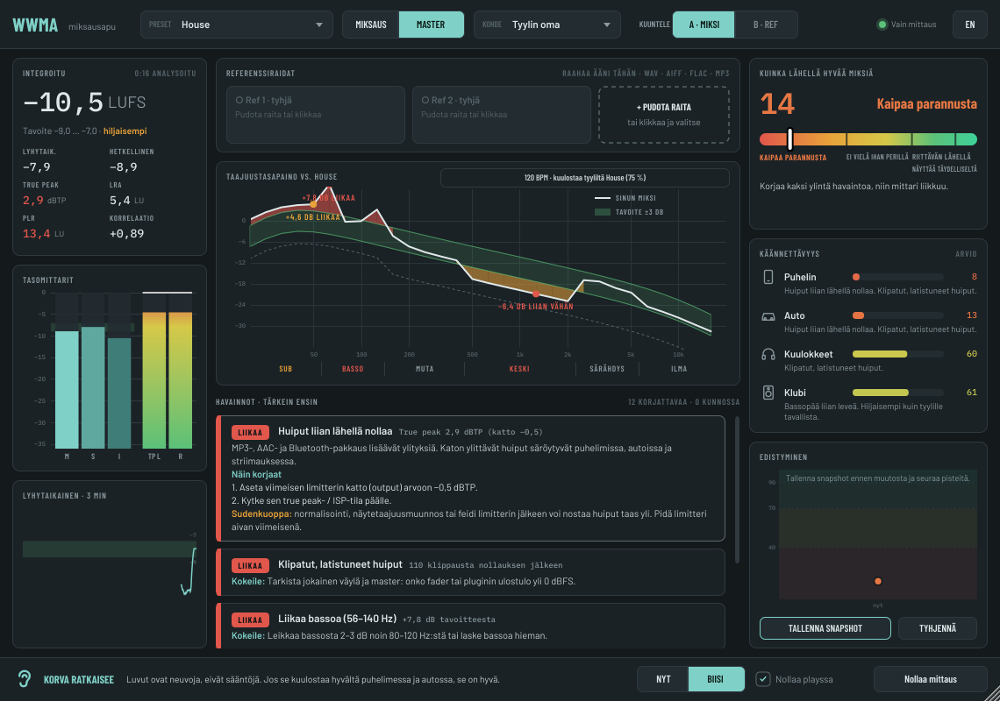

# WWMA-opas: miksaa paremmin, opi samalla

> **Huom: WWMA on 100 % vibe-koodattu**, eli tehty kokonaan tekoälyavustajan kanssa. Asennus ja käyttö omalla vastuulla, eikä takuuta ole. Se on tehty hyvässä uskossa ja siinä toivossa, että siitä on jollekin hyötyä.

WWMA ei korjaa mitään puolestasi. Se kuuntelee miksauksesi, kertoo selkokielellä, mitä on selvästi tai vähän liikaa tai liian vähän, ja neuvoo, miten korjaat sen itse. Tavoite on, että ajan mittaan et tarvitse sitä enää.

**Korva ratkaisee.** Luvut ovat neuvoja, eivät sääntöjä. Jos se kuulostaa hyvältä puhelimessa ja autossa, se on hyvä.

## 1. Käyttöönotto

1. Laita WWMA masterväylän **viimeiseksi** pluginiksi, limitterin jälkeen.
2. Valitse **Preset**: oma tyylisi. Elektroniset ovat listan alussa. Jos et ole varma, soita kappaletta 15 sekuntia: WWMA ehdottaa lähintä tyyliä (ks. alla).
3. Valitse **MIX**, kun vielä miksaat. Silloin äänekkyyttä ja huippuja ei arvioida, vain tasapainoa, leveyttä, dynamiikkaa ja rumpuja. Valitse **MASTER**, kun masteroit.
4. Valitse **Target** eli äänekkyystavoite. Tyylin oma on hyvä alku. Jos kappale menee vain suoratoistoon, −14 LUFS riittää.
5. Soita koko kappale **BIISI**-tilassa tai looppaa työstettävää kohtaa **NYT**-tilassa. Kielen vaihdat oikean yläkulman FI/EN-napista.

## 2. Näytön osat

- **Integroitu äänekkyys** (vasen ylhäällä): kappaleen keskimääräinen äänekkyys LUFS-yksikössä sekä short-term, momentary, true peak, LRA, PLR ja korrelaatio.
- **Tasomittarit**: M, S ja I sekä true peak kanaville L ja R. Vihreä kaista on tavoitealue.
- **Taajuustasapaino**: miksauksesi (valkoinen) tyylin käytävää (vihreä) vasten. Punainen tarkoittaa liikaa, oranssi liian vähän. Alueiden nimet ovat SUB, BASSO, MUTA, KESKI, SÄRÄHDYS ja ILMA.
- **Havainnot**: enintään neljä korjattavaa kerrallaan, tärkein ensin. "Kokeile:" kertoo ensimmäisen askeleen. Klikkaa korttia, niin näet syyn, kaikki askeleet ja tyypillisen **sudenkuopan**.
- **Kuinka lähellä hyvää miksiä**: pisteet 0–100 ja sanallinen taso:
  - Kaipaa parannusta (0–40)
  - Ei vielä ihan perillä (40–70)
  - Riittävän lähellä (70–90)
  - Näyttää täydelliseltä (90–100)
- **Käännettävyys**: arvio siitä, miten miksaus kestää puhelimessa, autossa, kuulokkeilla ja klubilla.
- **Edistyminen**: tallenna snapshot ennen muutosta. Kortit näyttävät sen jälkeen, mikä parani tai huononi, ja kaavio näyttää kehityksen. Katso luku 4.
- **Mono-tarkistus**: varoittaa, jos basso tai leveä syna hiljenee, kun miksi summataan monoksi (klubi, puhelin ja moni Bluetooth-kaiutin soittavat monona).
- **Referenssiraidat**: raahaa ikkunaan kappale, josta pidät (WAV, AIFF, FLAC tai MP3). Plugin analysoi sen kerran, jonka jälkeen:
  - sen käyrä näkyy violettina katkoviivana
  - "Miksi vs referenssi" -taulukko näyttää erot
  - jokaisessa havainnossa näkyy myös ero referenssiin.

  **A/B**-kytkin soittaa referenssiä miksauksesi tilalla samalla äänekkyydellä. Se on ainoa tilanne, jossa WWMA muuttaa kuulemaasi, ja silloin yläpalkin merkki muuttuu violetiksi.

  Referenssin soittaminen pluginissa:
  - **▶ / ❚❚** pienen aaltomuodon vieressä soittaa ja pysäyttää referenssin, vaikka DAW olisi pysähdyksissä. Tauko palauttaa miksisi ja muistaa kohdan.
  - **Klikkaa tai raahaa pientä aaltomuotoa** kelataksesi.
  - **Klikkaa raidan nimeä tai lukemia**, niin aukeaa iso näkymä. Siinä voit hypätä klikkaamalla, **raahata aaltomuodon yli valitaksesi loopin**, säätää loopin reunoja raahaamalla sekä käyttää **Soita looppi**- ja **Poista looppi** -nappeja.
  - Kun suljet ison näkymän, looppi jää voimaan: se näkyy pienessä aaltomuodossa, ja ▶ soittaa vain sitä kohtaa yhä uudelleen. Looppi tallentuu projektin mukana.

## 3. Tyyliehdotus

Noin 15 sekunnin jälkeen WWMA arvaa, mitä presettiä kappale muistuttaa eniten, ja näyttää sen taajuustasapainon yläreunassa, esimerkiksi "Kuulostaa tyyliltä Drum & Bass (40 %) · 174 BPM – vaihdetaanko?". Klikkaa, niin preset vaihtuu. **Mikään ei muutu, ellet klikkaa.**

Arvaus perustuu kolmeen asiaan, eikä siinä ole koneoppimista:

- **Tempo** lasketaan siitä, kuinka säännöllisesti rumpuiskut toistuvat. Half-time ymmärretään, joten 87 BPM:nä kuuluva drum & bass lasketaan 174:ksi.
- **Taajuustasapainoa** verrataan jokaisen presetin käytävään.
- **Dynamiikka** vaikuttaa myös: hyvin dynaaminen kappale tuskin on klubityyliä.

Prosentti jaetaan lähisukulaisten kesken: "House 72 %" tarkoittaa koko house-perhettä (House, Deep, Tech, Afro, Minimal). Samassa tempossa olevat tyylit, kuten techno ja UK garage 132 BPM:ssä, menevät helposti sekaisin, joten oma valintasi ja korvasi ratkaisevat.

## 4. Snapshotit, ennen/jälkeen ja DAW-versiot

1. Paina **Snapshot** ennen kuin muutat jotain. WWMA tallentaa pisteet ja kaikki tärkeät lukemat.
2. Edistyminen-paneeli pyytää sen jälkeen **tallentamaan DAW-projektin uutena versiona** (File > Save As..., esim. "Biisi v3"). Näin pääset aina takaisin muutosta edeltävään miksiin.
3. Kun olet tallentanut, kuittaa painamalla **Tallensin**. Muistutus pysyy näkyvissä siihen asti, ja snapshot muistaa, että sille on DAW-versio (✓ kaaviossa).
4. Tee muutos ja soita sama kohta uudestaan. Taajuustasapainossa näkyy snapshotin käyrä himmeänä turkoosina **haamukäyränä**, ja ero sen ja miksisi välillä on täytetty sinisellä, joten näet heti, kuinka paljon sointi on muuttunut. Selitteen **Ero**-ruudusta saat täytön pois päältä tai takaisin.
5. Paina **Ennen/jälkeen**: taulukko näyttää jokaisen lukeman ennen ja nyt, merkittynä PAREMPI, HUONOMPI tai =.

## 5. Opettelutila

**Opettele**-napista saat lyhyitä käytännön tehtäviä havaintojen tilalle. Jokainen kertoo miksi asia on tärkeä ja mitä tehdä, ja palkki täyttyy, kun lähestyt tavoitetta. Tehtävä on valmis, kun tavoite pysyy 3 sekuntia musiikkia. Looppaa kohtaa ja säädä samalla, kun katsot.

1. Duckaa basso kickin alle
2. Tee bassopäästä mono
3. Saa basso kuulumaan puhelimessa
4. Siivoa muta
5. Päästä rummut läpi
6. Tee miksistä monokelpoinen
7. Jätä tilaa masteroinnille
8. Saavuta tyylin äänekkyys litistämättä

Valmiit tehtävät saavat täytetyn pallon, ja edistys tallentuu projektin mukana. Plugin ei koske ääneen: sinä teet työn.

## 6. Miksausraportti

**Raportti**-napista tallennat raportin Markdown-tiedostona (aukeaa missä tahansa tekstieditorissa). Siinä on pisteet, käännettävyys, korjattavat asiat ohjeineen, kaikki lukemat, referenssin lukemat ja snapshotit. Viereen tallentuu JSON-kopio. Kun samassa kansiossa on aiempi raportti, uusi raportti kertoo **mikä parani tai huononi edellisen jälkeen**. Pidä siis yhden biisin raportit samassa kansiossa (oletus: Documents/WWMA Reports).

## 7. Hyvä työjärjestys

1. **Tasapaino ensin.** Säädä faderit ennen pluginien lisäämistä. Kick ja basso ensin, sitten virveli, sitten liidi tai vokaali, sitten loput.
2. **Matalat kuntoon.** Päätä, kumpi omistaa subin, kick vai basso. Pidä kaikki alle noin 120 Hz monona. Ylipäästösuodata muut äänet.
3. **Muta pois.** 200–400 Hz kertyy helposti, kun monta täyteläistä ääntä soi yhtä aikaa. Leikkaa sieltä, missä sitä ei tarvita.
4. **Rummut esiin.** Anna kickin duckata bassoa (sidechain). Käytä hitaampaa attackia väyläkompressoreissa, jotta transientit pääsevät läpi.
5. **Tila ja leveys.** Pidä tärkeät äänet keskellä ja levitä tukiosat sivuille. Tarkista monona.
6. **Masterointi vasta lopuksi.** Jätä miksaukseen tilaa (huiput noin −6…−3 dBFS). Lisää limitteri vasta MASTER-vaiheessa ja säädä katto (−1 dBTP) sekä äänekkyys tyylin mukaan.

## 8. Perusasiat lyhyesti

### EQ

- **Leikkaa ennen kuin korostat.** Jos jotain puuttuu, kysy ensin, mikä sitä peittää.
- **Kapea leikkaus, leveä korostus.** Resonanssit leikataan kapealla (Q 4–8), sävyä muokataan loivasti.
- **Ylipäästö on hyvä, mutta älä liioittele.** Liian korkealle asetettu suodin vie rungon.

### Kompressio

- **Attack** määrää, pääseekö isku läpi: 10–30 ms antaa transientin mennä läpi, 0–5 ms litistää sen.
- **Release** tempon mukaan: lyhyempi pumppaa, pidempi liimaa.
- Pinoa mieluummin monta kevyttä kompressoria (1–3 dB kukin) kuin yksi kova.

### Sidechain eli basson duckaus

- Laita kompressori bassoon ja kick sen sivuketjuun.
- Hyvä alku: suhde 4:1, attack 0–5 ms, release 100–200 ms tempon mukaan ja 3–6 dB vaimennus.
- Volume shaper -tyyppinen plugin tekee saman.

### Kick ja virveli

- **Kick tarvitsee** painoa 50–70 Hz:ssä ja klikkiä 2–5 kHz:ssä, jotta se kuuluu myös puhelimesta.
- **Virveli tarvitsee** runkoa noin 200 Hz:ssä ja napsua 2–5 kHz:ssä.
- Jos rummuista puuttuu terävyys, syyllinen on usein limitteri tai väyläkompressori, ei EQ.

## 9. Yleiset sudenkuopat (WWMA huomaa nämä)

| Sudenkuoppa | Mitä tapahtuu | Mitä tehdä |
|---|---|---|
| Kick ja basso peittävät toisensa | Groove menettää iskunsa, auto jumputtaa | Duckaus, eri huippukohdat, lyhyemmät bassonuotit |
| Pelkkää subia, ei harmonisia | Basso katoaa puhelimesta | Saturaatio, kerros oktaavia ylempää |
| Leveä bassopää | Basso kumoutuu monona ja klubilla | Bass mono alle 120 Hz |
| Vaiheongelmat | Osia katoaa monona | Etsi leventäjät, Haas-viiveet ja käännetyt kerrokset |
| Ylikompressio ja ylilimitointi | Iskut katoavat, kuuntelu väsyttää | Höllennä limitteriä, hitaampi attack |
| Äänekkyyssota | Suoratoisto laskee tason, jäljelle jää vain haitta | Tyylille riittävä äänekkyys riittää |
| True peak -ylitykset | Säröä MP3-, AAC- ja Bluetooth-toistossa | Limitterin katto −1 dBTP, ISP-tila päälle |
| Klippaus | Kireä särö, pakkaus pahentaa | Laske tasoa ennen limitteriä |
| Ei tilaa masteroinnille | Masteroitavaa ei jää | Huiput −6…−3 dBFS miksatessa |
| Miksaus limitterin läpi | Tasapaino-ongelmat piiloutuvat | Miksaa ilman limitteriä, vertaa tasatulla tasolla |
| Särähtävät yläkeskiäänet | Väsyttää etenkin puhelimessa | Etsi syyllinen, dynaaminen EQ |
| Sibilanssi | S-äänteet roiskuvat nappikuulokkeissa | De-esser vokaaliin ja kaikulähetyksiin |
| Jyrinä alle 30 Hz | Syö tilaa, limitteri pumppaa | Ylipäästö 25–30 Hz bassoon ja kickiin |
| Jumittava bassonuotti | Yksittäiset nuotit hyppäävät esiin | Kapea leikkaus tai dynaaminen EQ |
| Leventäjä diskantissa | Kirkkaus katoaa monona | Vähemmän leveyttä, jotain kirkasta keskelle |
| L/R-epätasapaino | Kuulokkeilla pää vetää sivulle | Tasapainota panorointi |
| DC-siirtymä | Hukkaa tilaa, naksuu leikkauksissa | DC-suodin tai ylipäästö 10–20 Hz |

### Kuunteluympäristö johtaa harhaan

- **Huone ja basso.** Useimmat huoneet korostavat joitain bassonuotteja ja nielevät toisia. Luota bassossa mittariin ja hyviin kuulokkeisiin.
- **Kova kuuntelu.** Se saa kaiken kuulostamaan jännittävältä. Kuuntele välillä niin hiljaa, että pystyt puhumaan päälle.
- **Korvien väsyminen.** 45–60 minuutin jälkeen diskantti tuntuu tylsemmältä, joten sitä tulee lisättyä. Pidä taukoja.
- **Kovempi kuulostaa paremmalta.** Tasaa äänekkyys aina ennen vertailua. A/B-kytkin tekee sen referenssille.
- **Soolo johtaa harhaan.** Tee päätökset kaiken soidessa.

## 10. Muista

- Pisteet kertovat, kuinka lähellä tyylin tyypillistä masteria olet. Ne eivät kerro, onko biisi hyvä.
- Presetit ovat valistuneita arvauksia yleisestä käytännöstä. Tarkin tavoite on referenssiraita, josta pidät.
- Tarkista lopuksi aina puhelimesta ja autossa. Jos se kuulostaa niissä hyvältä, se on hyvä.

Jokainen tarkistus on selitetty englanniksi [käyttöohjeessa](MANUAL.md).
